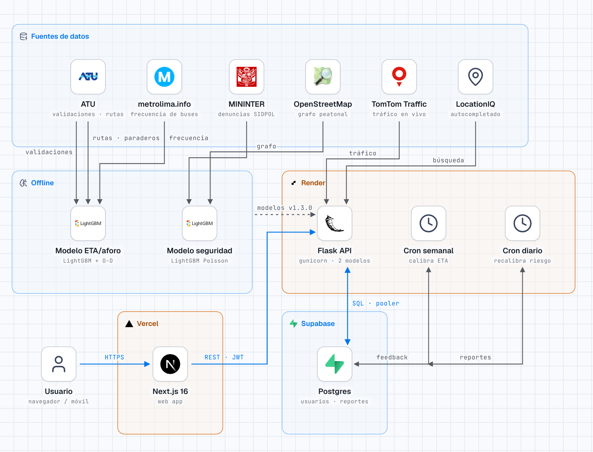

# UrbanSafe AI: Ecosistema de Movilidad Predictiva y Segura

**Curso:** DS3022 Desarrollo de Producto de Datos (UTEC, 2026-2)

| | Enlace |
| :--- | :--- |
| Aplicación web (Vercel) | <https://dpd-project.vercel.app> |
| API REST (Render) | <https://urbansafe-api.onrender.com/api/health> · documentación Swagger en [`/apidocs`](https://urbansafe-api.onrender.com/apidocs) |
| Base de datos | Supabase (PostgreSQL, vía *pooler*); credenciales fuera del repositorio |
| Repositorio | <https://github.com/EV081/DPD_project> |
| **Entrega final (S15)** | [`deliveries/week15/`](deliveries/week15/) · informe: [`FinalReport.pdf`](deliveries/week15/FinalReport.pdf) |
| Video demo | *pendiente: se agregará el enlace tras subirlo* |
| Datos ATU originales (Drive) | <https://drive.google.com/drive/folders/1qktczst2lUi7BqOt3Lr5ffcip9wqOSSw> |

> La API está en el plan gratuito de Render: si estuvo inactiva, **el primer pedido tarda ~50 s** en
> despertar el servidor. Abrir antes `https://urbansafe-api.onrender.com/api/health` evita la espera.

---

## 1. Equipo de Trabajo y Responsabilidades

| Integrante | Rol |
| :--- | :--- |
| **Elmer Jose Manuel Villegas Suarez** | *Data Engineer y full stack* — ingesta, pipelines y diccionarios de datos; infraestructura y despliegue (Vercel, Render, Supabase, Docker); Eje 2 (denuncias, riesgo y ruteo); desarrollo full stack junto con Alessandro y documentación. |
| **Alessandro Facundo Freed Monzón Gallegos** | *Data Product Manager, AI/ML Developer y full stack* — requerimientos, backend y frontend (junto con Elmer). |
| **Juan David Velo Poma** | *Data Scientist* — Eje 1: modelado, explicabilidad y evaluación (pronóstico de demanda y aforo, matriz O-D). |

---

## 2. Problema y Propuesta de Valor

En el transporte público de Lima (Metro L1, Metropolitano con sus alimentadores y Corredores
Complementarios) el usuario no sabe **cuánto falta para la próxima unidad ni qué tan llena viene**.
UrbanSafe AI responde dos preguntas:

* **Eje 1 — ¿subo a la próxima unidad?** Pronostica la demanda por hora, estima la **ocupación a
  bordo** (asientos / de pie / saturado), el ETA y la probabilidad de no poder subir, y **recomienda**
  abordar, esperar la siguiente o cambiar de paradero.
* **Eje 2 — ¿por dónde camino?** Para la primera y última milla (~10 min a pie de una estación o
  paradero) propone la **ruta peatonal más segura** con un riesgo por calle estimado de denuncias
  policiales, y recibe reportes de los usuarios (acoso, seguimiento, robo).
* **Simulador (Eje 1):** para quien ya conoce su paradero y servicio (Metro L1, Metropolitano, corredores o
  alimentadores), elige un día y una hora y la app muestra qué opción conviene tomar (ocupación, espera,
  recomendación y plan de salida; descarga en CSV).

**Fuentes de datos**

| Fuente | Uso |
| :--- | :--- |
| **ATU: validaciones 2025** (solicitud de acceso a la información; Metro L1, troncal, alimentadores y corredores) | Demanda horaria: entrenamiento y evaluación del Eje 1 |
| **ATU: rutas, servicios y paraderos** (catálogo oficial y fichas de horarios) | Red de líneas, matriz O-D y oferta |
| **metrolima.info** | Frecuencia aproximada de paso de cada bus y horarios del Metro de Lima |
| **Denuncias SIDPOL** (MININTER, Lima y Callao, hasta 2025) | Riesgo por calle del Eje 2 |
| **OpenStreetMap** | Grafo peatonal y puntos de interés del Eje 2 |
| TomTom Traffic API (opcional) | Ajuste del ETA de buses con la congestión en vivo |
| LocationIQ (opcional) | Autocompletado de destinos |

Las etapas S05–S07 usaron como proxy datos de TransMilenio (Bogotá) mientras llegaban los datos ATU;
desde la S08 todo el proyecto usa los datos reales de Lima.

---

## 3. Arquitectura



*Diagrama hecho con la skill [`stack-diagram`](https://github.com/caru-ini/stack-diagram); versión oscura y HTML en
[`deliveries/week15/diagrams/`](deliveries/week15/diagrams/).*

* **Datos:** ATU (validaciones y catálogo de rutas/paraderos), metrolima.info (frecuencias), MININTER/SIDPOL
  (denuncias), OpenStreetMap (grafo) y, en tiempo real, TomTom y LocationIQ.
* **Dos modelos separados, entrenados offline:** *ETA/aforo* (LightGBM + matriz O-D) y *seguridad*
  (LightGBM Poisson). La API en Render los carga como artefactos versionados (v1.3.0, sha256).
* **Capas:** web en **Vercel**, API Flask en **Render** (Docker + gunicorn) y base de datos en **Supabase**
  (usuarios, reportes y feedback).
* **Calibración con el uso (Cron Jobs de Render):** el job semanal re-ajusta el factor del ETA con el feedback
  «Ya abordé» (se promueve solo si mejora al vigente) y el diario recalibra el riesgo de las calles con los
  reportes de usuarios. Es *calibración*; el re-entrenamiento completo de los modelos es offline y la
  integración del feedback al entrenamiento es trabajo futuro.

* **Eje 1:** LightGBM pronostica las subidas por hora → una **matriz origen-destino** (Furness /
  gravedad, Ortúzar y Willumsen) estima bajadas y carga a bordo → con la oferta (horario o flota) se
  obtienen pasajeros por vehículo, clase de aforo, ETA, P(no subir) y la recomendación por costo
  generalizado. Para fechas de 2026 se usa el día homólogo de 2025.
* **Eje 2:** LightGBM Poisson estima eventos por segmento de calle → costo `largo × (1 + λ·riesgo)`
  (λ = 12) → Dijkstra entre el usuario y la estación. Los reportes de usuarios recalibran el riesgo
  de forma acotada.
* La demanda y los modelos viajan como archivos versionados: la API no necesita una base de datos de
  demanda. Postgres (Supabase) guarda solo usuarios, reportes y feedback.

---

## 4. Estructura del Repositorio

```
DPD_project/
├── README.md                  ← este archivo
├── docker-compose.yml         ← db + backend (:5000) + frontend (:3002); perfiles test y pipeline
├── render.yaml                ← despliegue de la API en Render (Blueprint)
├── .env.example               ← variables para docker compose
├── requirements.txt           ← entorno de análisis (EDA, notebooks y evaluación S08–S09)
├── backend/                   ← API Flask: rutas, servicios, modelos serializados, datos de contexto, 217 tests
│   ├── model/                 ← inferencia, matriz O-D, ocupación, recomendación
│   ├── models/                ← artefactos v1.3.0 + manifest.json (sha256) + model cards
│   ├── data/                  ← contexto ATU 2025, geo (paraderos y trazados), grafo del Eje 2
│   ├── scripts/               ← construir líneas/rutas O-D, entrenar, evaluar y serializar
│   └── docs/                  ← MODELO_OCUPACION.md, EJE2_RUTA_SEGURA.md, INTEGRACION_FRONTEND.md
├── frontend/                  ← aplicación web Next.js (mapa, estación, búsqueda, cuenta, reportes)
└── deliveries/                ← entregables semanales del curso
    ├── week04–week07/         ← ideación, propuesta, requerimientos, EDA y selección de modelos (etapa TransMilenio)
    ├── week08/                ← datos reales ATU 2025: EDA y modelado por sistema
    ├── week09/                ← avance S09: evaluación v2, data_csv/ y PresentationWeek09
    ├── week10/                ← pipeline PostgreSQL + Docker, modelos v1.0.0, PrototypeReport y PresentationWeek10
    ├── week12/                ← Eje 2 (EDA, features, modelo y ruteo) y EvaluationReport del Eje 1
    └── week15/                ← **entrega final**: FinalReport (.tex/.pdf), PresentationFinal, Data Product Canvas, Requirements, diagramas, página del proyecto y guion del video
```

---

## 5. Instalación y Ejecución

Requisitos: **Python 3.12**, **Node.js 20+** y, para la opción A y las pruebas, **Docker**.

### 5.A Todo con Docker (recomendado)

```bash
git clone https://github.com/EV081/DPD_project.git
cd DPD_project
cp .env.example .env            # opcional: API_TOMTOM, LOCATIONIQ_TOKEN
docker compose up --build       # Postgres + API (http://localhost:5000) + web (http://localhost:3002)
```

### 5.B Backend y frontend por separado

```bash
# API (terminal 1)
cd backend
python -m venv .venv
source .venv/bin/activate       # Windows: .venv\Scripts\activate
pip install -r requirements.txt
cp .env.example .env            # sin DATABASE_URL usa SQLite local
python app.py                   # http://localhost:5000/api/health · Swagger: http://localhost:5000/apidocs

# Web (terminal 2)
cd frontend
npm ci
echo "NEXT_PUBLIC_API_URL=http://localhost:5000/api" > .env.local
npm run dev                     # http://localhost:3000
```

### 5.C Pruebas del backend

```bash
docker compose --profile test up -d db-test      # Postgres de pruebas (puerto 5433, en memoria)
cd backend
pip install pytest
python -m pytest                                 # 217 pruebas: Furness, calendario, API, latencia P95, recarga de modelos, Eje 2
```

### 5.D Reproducir datos y modelos

| Qué | Dónde |
| :--- | :--- |
| Pipeline de datos ATU (descarga, limpieza, PostgreSQL) | [`deliveries/week10/README.md`](deliveries/week10/README.md) |
| EDA y evaluación v2 del pronóstico de demanda | [`deliveries/week09/README.md`](deliveries/week09/README.md) |
| Matriz O-D, ocupación, entrenamiento y serialización (Eje 1) | [`backend/README.md`](backend/README.md) y [`backend/docs/MODELO_OCUPACION.md`](backend/docs/MODELO_OCUPACION.md) |
| Riesgo por calle y ruteo seguro (Eje 2) | [`deliveries/week12/docs/Model_Eje2.md`](deliveries/week12/docs/Model_Eje2.md) (notebooks en `deliveries/week12/code/eje2/`) |

Los datos procesados que usa la app ya están en `backend/data/`; los datos ATU originales (≈ 250 MB
en ZIP) están en el enlace de Drive del inicio.

### 5.E Despliegue

* **Base de datos:** Supabase (PostgreSQL). Usar la URL del *pooler* como `DATABASE_URL`.
* **API:** Render con [`render.yaml`](render.yaml) (Docker, `rootDir: backend`). Variables:
  `DATABASE_URL` (Supabase), `JWT_SECRET_KEY`, `LOCATIONIQ_TOKEN`, `API_TOMTOM`. Cron Jobs: `pipeline-diario`
  (03:00 Lima) y `pipeline-semanal` (lunes 02:00 Lima), ver `backend/README.md`.
* **Web:** Vercel con `frontend/` como raíz y `NEXT_PUBLIC_API_URL=https://urbansafe-api.onrender.com/api`.

---

## 6. Modelos y Resultados (test fuera de muestra)

| Componente | Modelo | Resultado principal |
| :--- | :--- | :--- |
| Demanda por hora (Eje 1) | LightGBM por sistema | WMAPE 0,10–0,12 en Metro L1, troncal y corredores (baseline media_4sem 0,13–0,17); alimentadores 0,48 |
| Aforo que ve el usuario (Eje 1) | LightGBM + matriz O-D | F1-macro: Metro L1 0,86 · troncal 0,93 · corredores 0,66 · alimentadores 0,54 (accuracy 0,86–0,93) |
| Recomendación (Eje 1) | Costo generalizado + P(no subir) | Acierto 96,8–99,8 % por sistema (AC-03 ≥ 80 %) |
| Riesgo por calle (Eje 2) | LightGBM Poisson | El 5 % de calles más riesgosas concentra el 70,2 % de los eventos de 2024 |
| Ruta segura (Eje 2) | Dijkstra con λ = 12 | 43,8 % menos eventos en la ruta con 8,7 % más de distancia (test 2024) |

Detalle, baselines y limitaciones en
[`deliveries/week12/docs/EvaluationReport_Eje1.md`](deliveries/week12/docs/EvaluationReport_Eje1.md) y
[`deliveries/week12/docs/Model_Eje2.md`](deliveries/week12/docs/Model_Eje2.md).

> **Sobre el F1-macro:** corredores (0,66) y alimentadores (0,54) no cumplen el umbral de RNF-01 (≥ 0,72) porque la
> clase «Saturado» es rara en buses (1,5 % y 2,7 % de las horas de test) y el F1-macro pesa igual las tres clases;
> la accuracy sí cumple (0,86–0,93). Se explica en el informe final (§7.3).

---

## 7. Documentación

| Documento | Alcance |
| :--- | :--- |
| [`deliveries/week07/docs/Requirements.md`](deliveries/week07/docs/Requirements.md) | Requerimientos funcionales y no funcionales, casos de uso, criterios de aceptación. |
| [`deliveries/week08/docs/`](deliveries/week08/docs/) | EDA y modelado con datos ATU 2025, diccionarios de datos. |
| [`deliveries/week09/README.md`](deliveries/week09/README.md) | Estado del producto en la S09 y evaluación v2. |
| [`deliveries/week10/PrototypeReport.md`](deliveries/week10/PrototypeReport.md) | Prototipo funcional (S10). |
| [`deliveries/week15/FinalReport.pdf`](deliveries/week15/FinalReport.pdf) | **Informe final**: problema, datos, requerimientos, enfoque, arquitectura, evaluación, casos de estudio, limitaciones, contribución y reflexión. |
| [`deliveries/week12/docs/EvaluationReport_Eje1.md`](deliveries/week12/docs/EvaluationReport_Eje1.md) | Evaluación del Eje 1: demanda, aforo, O-D y recomendación. |
| [`deliveries/week12/docs/EDA_Eje2.md`](deliveries/week12/docs/EDA_Eje2.md) · [`Model_Eje2.md`](deliveries/week12/docs/Model_Eje2.md) | EDA de denuncias, modelo de riesgo y ruteo seguro. |
| [`backend/docs/`](backend/docs/) | Modelo de ocupación, Eje 2 en la API, contrato con el frontend. |

---

## 8. Cronograma de Entregables del Curso

| Semana | Entregable | Carpeta |
| :---: | :--- | :--- |
| S04–S05 | Problema, propuesta, Data Product Canvas, requerimientos | `deliveries/week04`, `week05` |
| S06–S07 | EDA, selección de modelos, Integrated Project Definition | `deliveries/week06`, `week07` |
| S08–S09 | Datos reales ATU 2025, modelado y evaluación v2 | `deliveries/week08`, `week09` |
| S10 | Prototipo funcional: pipeline, modelos serializados, API y frontend | `deliveries/week10`, `backend/`, `frontend/` |
| S11–S12 | Eje 2 (módulo peatonal) y evaluación | `deliveries/week12` |
| S13 | Despliegue cloud y Docker | `render.yaml`, `docker-compose.yml`, Vercel |
| S14–S15 | Informe final, presentación, Data Product Canvas, página del proyecto y guion del video (el video está pendiente) | `deliveries/week15` |

---

## 9. Licencia

El código de este repositorio se distribuye bajo la licencia **MIT** (ver [`LICENSE`](LICENSE)). Los datos de la ATU,
MININTER (SIDPOL) y OpenStreetMap, y los logos de terceros, mantienen sus propias licencias y condiciones de uso;
no se redistribuyen datos restringidos.

---

## 10. Referencias

* Ortúzar, J. de D. y Willumsen, L. G. *Modelos de Transporte*. (Furness, gravedad, estimación de
  matrices O-D desde conteos, costo generalizado).
* Galbrun, E., Pelechrinis, K. y Terzi, E. (2016). *Urban navigation beyond shortest route: the case
  of safe paths*. Information Systems 57.
* INEI (2025). *Percepción de la Inseguridad Ciudadana y Victimización en Áreas Urbanas de Lima
  Metropolitana*. <https://www.inei.gob.pe/estadisticas/indice-tematico/seguridad-ciudadana/>
* ATU (2026). *Hackathon 2026*. <https://www.gob.pe/institucion/atu/noticias/atu-lanza-la-hackathon-2026>
* ProTransporte & ATU. *Portal de Datos Abiertos*. <https://sistemas.protransporte.gob.pe/DatosAbiertos/>
* TomTom Traffic API. <https://docs.tomtom.com/traffic-api/>
* LightGBM. <https://github.com/microsoft/LightGBM>
