# Model — UrbanSafe AI (Week 08 · ATU Lima)

**Modelamiento preliminar de demanda por sistema**, con bakeoff de forecast en
walk-forward: **Chronos / LightGBM / AutoETS** + baselines. Un notebook / fit por
tipo de transporte (no un modelo Lima-global).

| | |
|--|--|
| Datos | `data_processed/clean/demanda_consolidada_fiable.parquet` (≥ 90% cobertura) |
| Split | train ≤ 2025-10-31 · eval: 2025-11-04, 11, 18 · 12-02, 12-09 |
| Forecast | Chronos Bolt · LightGBM (lags) · AutoETS (`statsforecast`) · `hora_media` · `naive_7d` |
| Código | `code/model/Modelamiento_*.ipynb` + `model_atu_common.py` |
| Figuras | `docs/images/model/<sistema>/` |

**Criterio de ganador:** menor **WMAPE** en el bakeoff. El pronóstico 24h operativo
usa ese ganador (`mejor_wmape` en el manifiesto).

**Nota metodológica:** no corrimos AutoARIMA en el grid completo (demasiado lento:
~12–45 series × 5 folds × 4 sistemas en horario). AutoETS cubre la familia clásica
estacional sin reventar el runtime.

Convención al leer cada figura:

| Bloque | Significa |
|--------|-----------|
| **Qué muestra** | Ejes / curvas |
| **Qué sacamos** | Número o patrón |
| **Importante porque** | Implicación para el producto / por qué separar modelos |

---

## 1. Por qué separar (y qué se ve en las series)

Cuatro modos, cuatro escalas y calendarios. Las series diarias (roja = split train|test;
verdes = días walk-forward) ya no se parecen entre sí:

### Metro L1

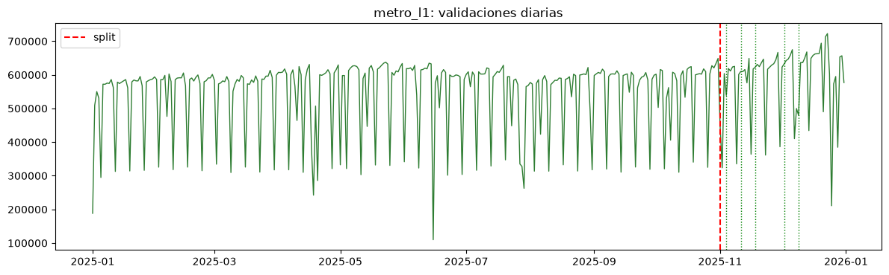

- **Qué muestra:** validaciones diarias agregadas de las 26 estaciones L1 en 2025.
- **Qué sacamos:** ciclo semanal estable; sábados no se caen como en buses; nivel alto
  y continuo tras el split.
- **Importante porque:** es el panel más “limpo” → mejor candidato a MVP de forecast.

### Troncal

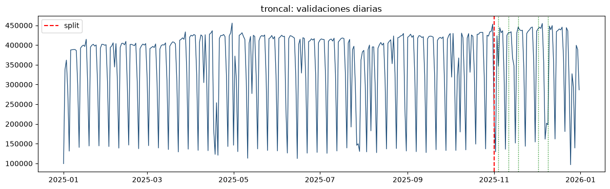

- **Qué muestra:** demanda diaria del Metropolitano (45 estaciones fiables).
- **Qué sacamos:** misma familia semanal que L1, pero más dientes y caídas (feriados /
  hubs); post-split el nivel sigue siendo usable.
- **Importante porque:** mismo grano (estación) que L1, pero **otra escala y más ruido**
  → no compartir los mismos pesos.

### Corredores

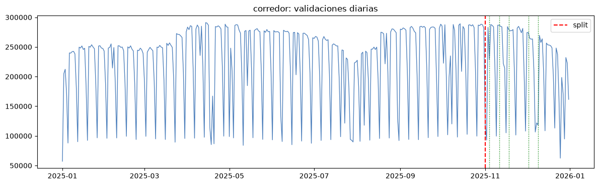

- **Qué muestra:** suma diaria de las **12 rutas** con cobertura ≥90% (no las 26).
- **Qué sacamos:** nivel alto pero más irregular; el panel ya excluyó rutas casi vacías.
- **Importante porque:** grano = **ruta** (paraderos sumados). Meter esto en un Chronos
  junto a estaciones L1 mezcla objetos distintos.

### Alimentadores

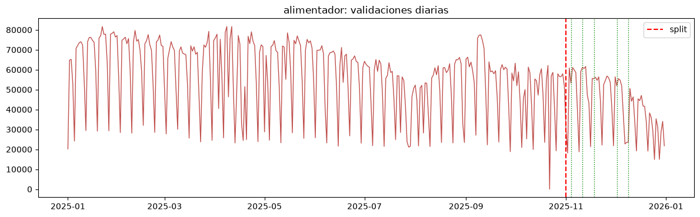

- **Qué muestra:** 23 líneas alimentadoras fiables.
- **Qué sacamos:** escala mucho menor y más “picos/valle”; visualmente más ruidosa.
- **Importante porque:** aquí un modelo unificado se ahogaría (o ignoraría) este modo;
  WMAPE ~0.48–0.51 lo confirma más abajo.

**Decisión:** un modelo por sistema. Pipeline compartido; pesos no.

---

## 2. Qué mide “qué tan bueno”

| Métrica | Uso |
|---------|-----|
| **MAE** | Error en validaciones/hora — **no** comparar entre sistemas |
| **WMAPE** | Error relativo — **sí** comparar modos y vs baselines |
| Walk-forward | Contexto solo hasta el día previo 23:00 |
| Matriz de aforo | Proxy Asientos/De_pie/Saturado vía `crowding_index` (sin leakage de validaciones en el clasificador) |

---

## 2.1 Aforo = crowding_index (proxy de presión, no ocupación)

Solo tenemos **validaciones de entrada**. Sin bajadas / APC no hay load profile a bordo;
el producto usa un **índice de presión de abordaje**:

$$
\text{crowding\_index} = \underbrace{\frac{\text{Validaciones}}{\text{Cap\_hora}}}_{\text{local}}
+ \alpha \cdot \underbrace{\frac{\overline{\text{Validaciones}}_{k\text{ previas}}}{\text{Cap\_hora}}}_{\text{upstream}}$$

| Pieza | Definición |
|-------|------------|
| `Cap_hora` | `Cap_vehiculo × (60 / Headway)` por bucket LAB/SAB/DOM |
| α | **`0.3`** — prior de producto, **no** calibrado con APC |
| k | **2** estaciones previas en orden norte→sur (solo L1 / troncal) |
| Rutas | corredor / alimentador: upstream = 0 (grano ≠ estación lineal) |
| Clases | Asientos / De_pie / Saturado con **p60 / p90 por franja** (punta_am, valle, punta_pm, noche) en train |
| Artefacto | `outputs/<sistema>/umbrales_crowding.csv` |

**Qué no es:** ocupación real a bordo. Es presión relativa para UI + **regla U**
(ETA × clase → abordar / esperar / cambiar paradero). Si llegaran salidas o APC, se
reemplaza el motor sin cambiar las 3 clases de producto.

---

## 3. Bakeoff — ¿quién sigue mejor el día?

En cada figura Chronos: negro = real; color = mediana Chronos (q50); banda = cuantiles;
gris punteado = `naive_7d`. Además: `bakeoff_wmape.png` por sistema.

### 3.1 Metro L1 — ganador **Chronos** WMAPE **0.155**

| Modelo | MAE | WMAPE |
|--------|----:|------:|
| **Chronos** | 131.5 | **0.155** |
| LightGBM | 138.0 | 0.161 |
| AutoETS | 159.9 | 0.179 |
| naive_7d | 165.1 | 0.193 |
| hora_media | 175.6 | 0.198 |

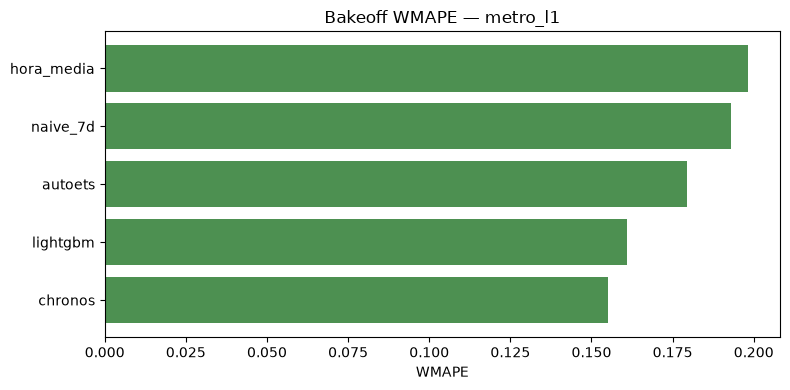
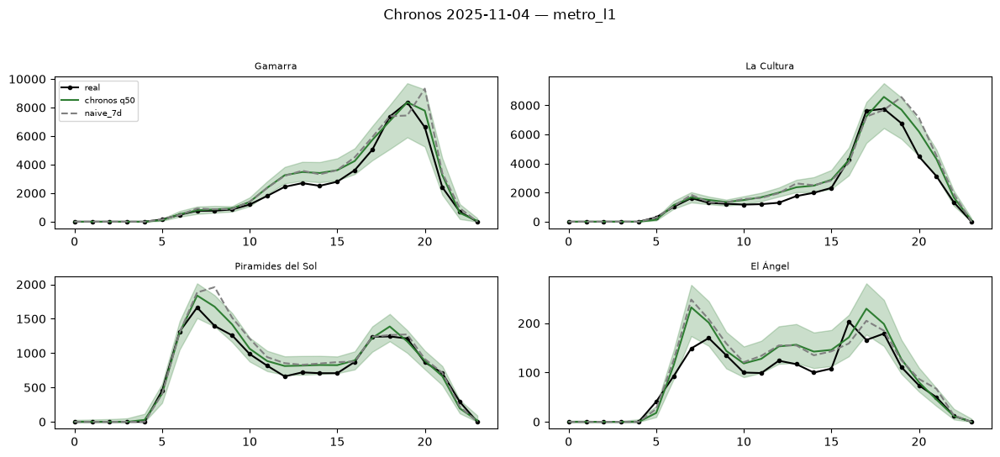

- **Qué muestra:** bakeoff WMAPE; 4 series real vs Chronos vs naive (2025-11-04).
- **Qué sacamos:** Chronos gana; LightGBM queda a ~0.6 pp. Panel limpio favorece al
  foundation model.
- **Importante porque:** ~20% menos WMAPE que naive → forecast usable en UI.

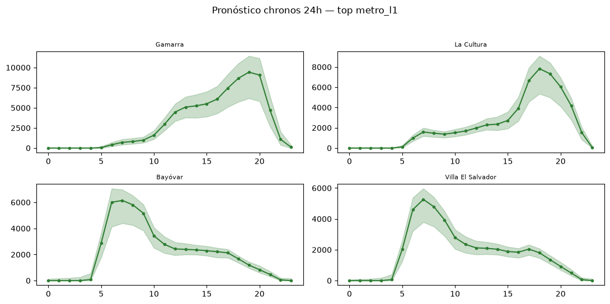

- **Qué muestra:** día futuro **Chronos** (top estaciones) con banda q10–q90.
- **Qué sacamos:** forma operativa clara (poca madrugada, punta mañana/tarde).
- **Importante porque:** salida lista para aforo proxy + recomendación regla U.

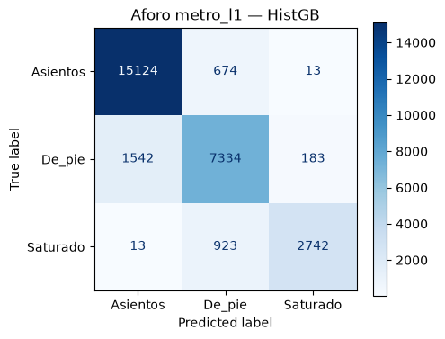

- **Qué muestra:** matriz de confusión del clasificador de aforo (etiquetas = `crowding_index` por franja).
- **Qué sacamos:** régimen estación×hora aprendible; Saturado sigue siendo la cola rara.
- **Importante porque:** aforo aquí es **presión de abordaje** (`§2.1`), no ocupación a bordo.

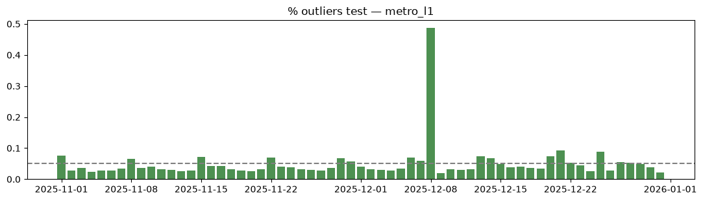

- **Qué muestra:** % outliers IsolationForest por día en test.
- **Qué sacamos:** días puntuales se salen del régimen train (feriados/eventos).
- **Importante porque:** alerta operativa, no etiqueta supervisada.

**Veredicto L1:** MVP de pronóstico del producto — **Chronos**.

---

### 3.2 Troncal — ganador **AutoETS** WMAPE **0.285**

| Modelo | MAE | WMAPE |
|--------|----:|------:|
| **AutoETS** | 85.9 | **0.285** |
| Chronos | 74.0 | 0.310 |
| hora_media | 94.9 | 0.329 |
| LightGBM | 87.3 | 0.350 |
| naive_7d | 103.1 | 0.412 |

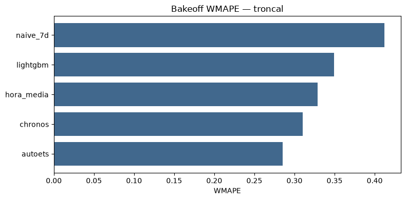
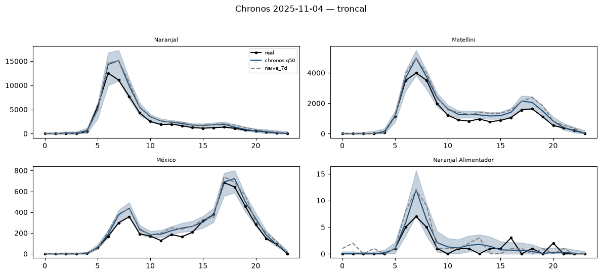

- **Qué muestra:** bakeoff; estaciones troncales real vs Chronos vs naive.
- **Qué sacamos:** Chronos tiene **mejor MAE** pero AutoETS **mejor WMAPE** (relativo).
  En hubs el error absoluto sube; WMAPE ~2× L1.
- **Importante porque:** no basta mirar MAE; el producto usa error relativo por unidad.

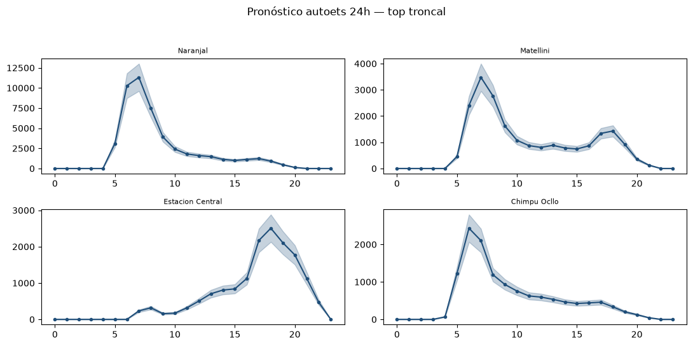

- **Qué muestra:** top demanda troncal 24h con **AutoETS** (bandas proxy ±15%).
- **Qué sacamos:** picos más marcados que L1 en algunas estaciones.
- **Importante porque:** la regla U (ETA×aforo) se calibra distinto que en metro.

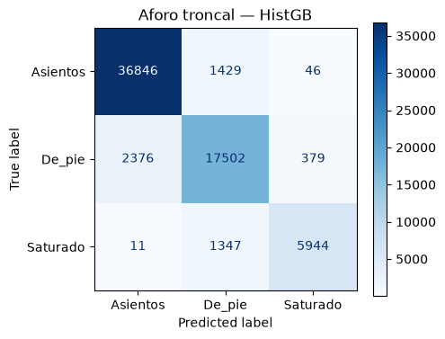

- **Qué muestra:** HistGB F1≈0.89 (etiquetas crowding por franja).
- **Qué sacamos:** régimen estación×hora aprendible, similar a L1.
- **Importante porque:** segundo MVP natural (transferir receta, no pesos).

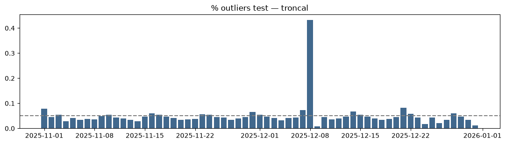

- **Qué muestra:** outliers diarios test.
- **Qué sacamos:** más días “pintados” que L1 → más sensibilidad a eventos.
- **Importante porque:** refuerza no mezclar métricas con L1 en un solo WMAPE.

**Veredicto troncal:** sí para MVP; default operativo **AutoETS** (WMAPE).

---

### 3.3 Corredores — ganador **AutoETS** WMAPE **0.215**

| Modelo | MAE | WMAPE |
|--------|----:|------:|
| **AutoETS** | 156.6 | **0.215** |
| Chronos | 173.9 | 0.311 |
| LightGBM | 199.2 | 0.347 |
| hora_media | 234.9 | 0.353 |
| naive_7d | 239.8 | 0.410 |

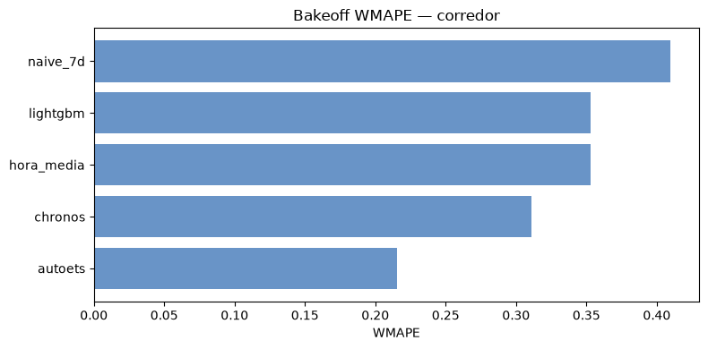
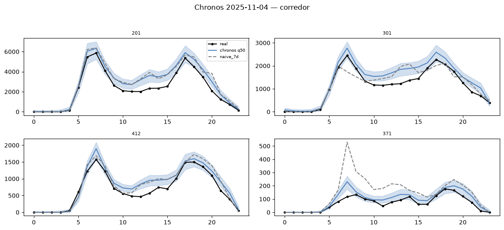

- **Qué muestra:** bakeoff; rutas (no estaciones) real vs Chronos.
- **Qué sacamos:** AutoETS baja el WMAPE ~10 pp vs Chronos en rutas agregadas.
- **Importante porque:** unificar con L1 mezclaría estación vs ruta; y aquí el clásico
  estacional gana al foundation.

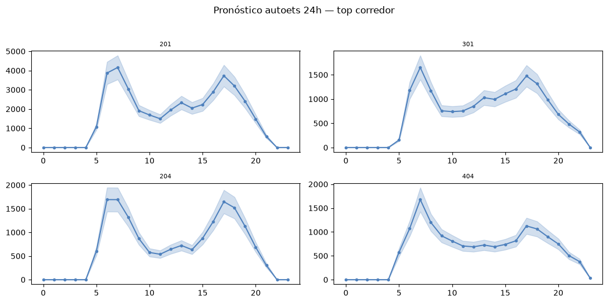

- **Qué muestra:** top rutas 24h (**AutoETS**).
- **Qué sacamos:** nivel alto (MAE grande) pero forma diaria clara en rutas fiables.
- **Importante porque:** solo 12/26 rutas están aquí; el modelo no habla por toda la red.

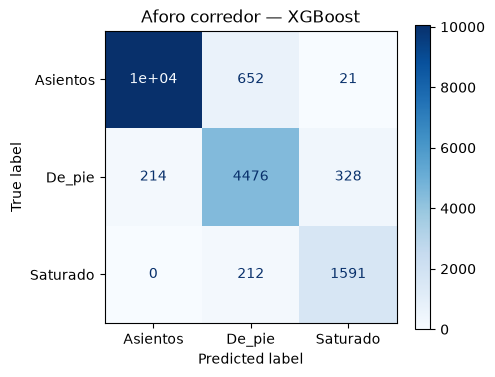

- **Qué muestra:** XGBoost F1≈0.89 (crowding; upstream=0 en grano ruta).
- **Qué sacamos:** proxy de aforo usable en rutas estables.
- **Importante porque:** headway/capacidad son más inciertos (prensa/referencia).

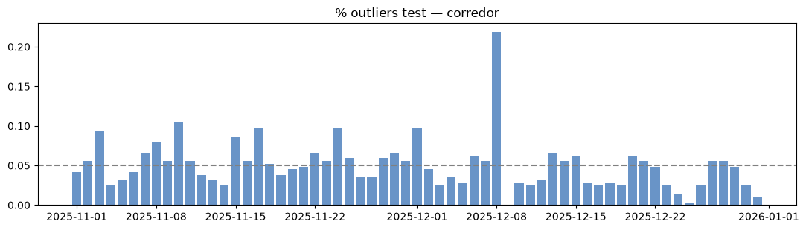

- **Qué muestra:** outliers test.
- **Qué sacamos:** días atípicos visibles; panel más corto en series.
- **Importante porque:** no entrenar rutas con 1–5 días dentro de este modelo.

**Veredicto corredores:** sí en rutas ≥90%; default **AutoETS**.

---

### 3.4 Alimentadores — ganador **AutoETS** WMAPE **0.483**

| Modelo | MAE | WMAPE |
|--------|----:|------:|
| **AutoETS** | 40.3 | **0.483** |
| Chronos | 37.9 | 0.507 |
| LightGBM | 40.1 | 0.529 |
| hora_media | 46.2 | 0.624 |
| naive_7d | 49.5 | 0.658 |

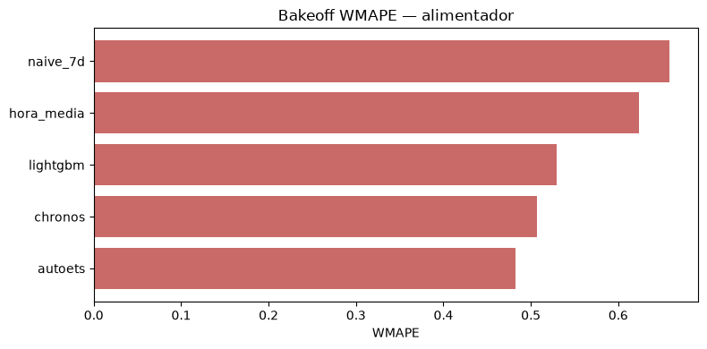
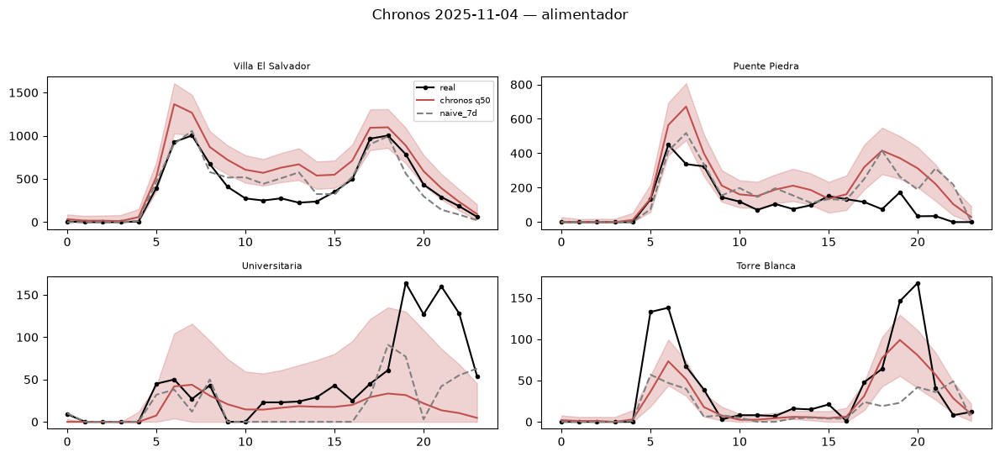

- **Qué muestra:** bakeoff; líneas alimentadoras real vs Chronos.
- **Qué sacamos:** AutoETS gana WMAPE; Chronos sigue cerca en MAE. Series con muchos
  ceros / picos → WMAPE ~48–50% sigue siendo alto.
- **Importante porque:** MAE bajo (~38–40) **no** significa “mejor que L1”; la escala
  es chica. El WMAPE dice la verdad.

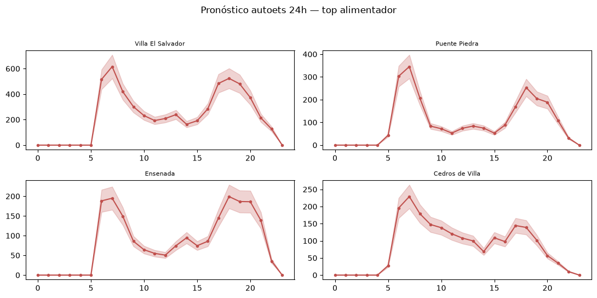

- **Qué muestra:** top líneas 24h (**AutoETS**).
- **Qué sacamos:** formas irregulares; bandas proxy.
- **Importante porque:** UI debe mostrar incertidumbre; no vender punto único.

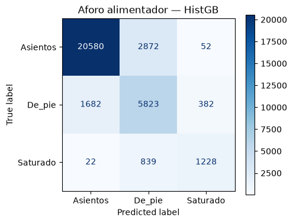

- **Qué muestra:** HistGB F1≈**0.74** (peor del cuarteto).
- **Qué sacamos:** mucha confusión entre clases de presión de abordaje.
- **Importante porque:** separar el modelo evita que este ruido contamine L1/troncal.

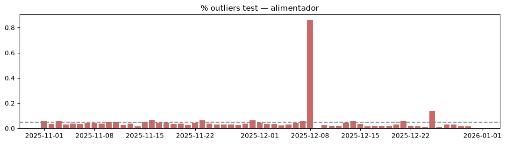

- **Qué muestra:** outliers test.
- **Qué sacamos:** proporción alta de días anómalos vs L1.
- **Importante porque:** justifica filtros de cobertura y modelos por línea a futuro.

**Veredicto alimentadores:** solo pilotos en líneas estables; default **AutoETS**;
modelo **obligatoriamente** aparte.

---

## 4. Comparativa visual: unificado vs separados

### 4.1 Tabla WMAPE (bakeoff — ganador en negrita)

| Sistema | Chronos | LightGBM | AutoETS | Mejor baseline | Default 24h |
|---------|--------:|---------:|--------:|---------------:|:-----------:|
| Metro L1 | **0.155** | 0.161 | 0.179 | 0.193 | Chronos |
| Troncal | 0.310 | 0.350 | **0.285** | 0.329 | AutoETS |
| Corredores | 0.311 | 0.347 | **0.215** | 0.353 | AutoETS |
| Alimentadores | 0.507 | 0.529 | **0.483** | 0.624 | AutoETS |

### 4.2 Experimento unificado L1+troncal (71 series)

Métricas: Chronos WMAPE **0.203** · MAE 95.

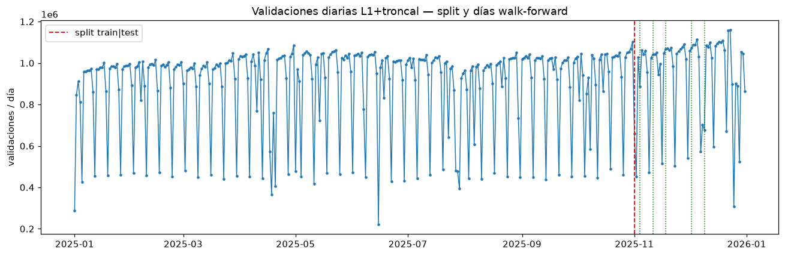

- **Qué muestra:** suma diaria mezclando L1 y troncal; split y días eval.
- **Qué sacamos:** una sola curva “Lima BRT+metro” que **esconde** el WMAPE 0.15 de L1
  y el 0.31 de troncal.
- **Importante porque:** un score 0.20 parece “casi L1”, pero no sirve para desplegar
  ni para diagnosticar hubs troncales.

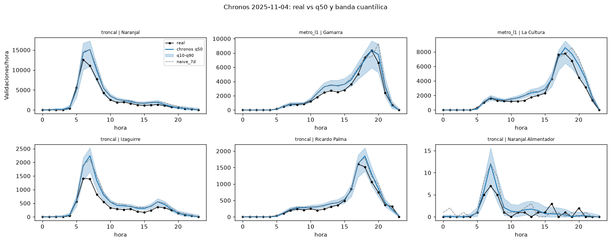

- **Qué muestra:** estaciones de **ambos** sistemas en el mismo fit.
- **Qué sacamos:** Chronos funciona, pero el error se reparte sin control por modo.
- **Importante porque:** el producto pregunta “¿cómo va *esta* estación del Metropolitano?”,
  no “¿cómo va el promedio L1∪troncal?”.

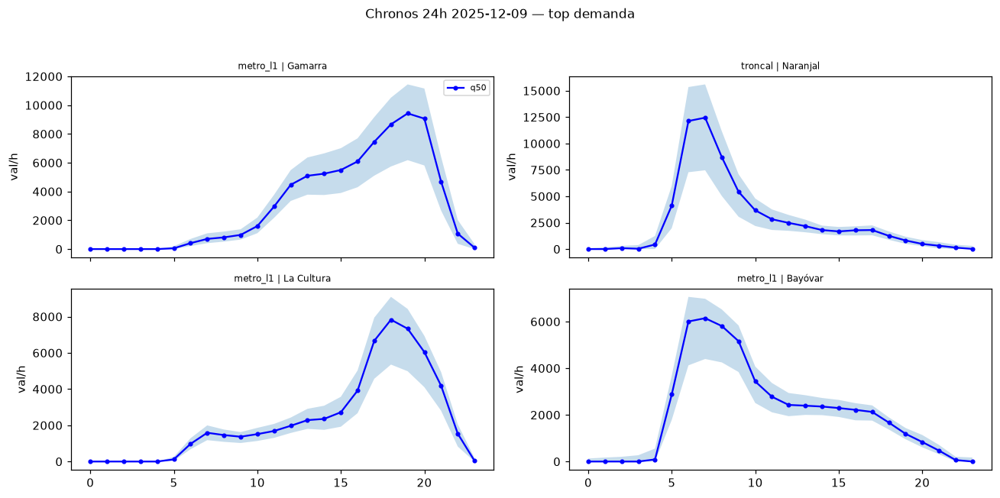

- **Qué muestra:** top demanda del modelo mezclado.
- **Qué sacamos:** ranking mezcla modos; no prioriza MVP por sistema.
- **Importante porque:** la UI y la regla U viven por modo/unidad.

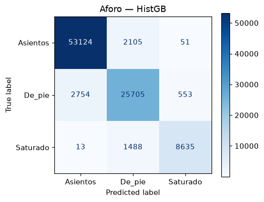

- **Qué muestra:** CM del clasificador sobre el panel mezclado.
- **Qué sacamos:** accuracy alta global ≠ calidad en alimentadores (F1 0.72 aparte).
- **Importante porque:** métricas globales maquillan el modo difícil.

### 4.3 Por qué separado > unificado (resumen)

1. Las **series** (§1) ya muestran escalas/calendarios distintos.
2. El **bakeoff por sistema** (§3) da WMAPE honestos y **cambia el ganador** según el modo
   (Chronos en L1; AutoETS en buses).
3. El **unificado** (§4.2) entrega un 0.20 opaco y mezcla granos cuando se suman rutas.
4. **Aforo/anomalías** empeoran justo donde el EDA dijo irregularidad (alimentadores).
5. En producto: un endpoint o head por modo; no un único peso Lima-global.

---

## 5. Qué tan bueno es cada modelo (para el producto)

| Sistema | ¿MVP forecast? | Default | Confianza | Lo que dicen las figuras |
|---------|----------------|---------|-----------|---------------------------|
| Metro L1 | **Sí** | Chronos | Alta | Serie limpia; Chronos gana bakeoff; CM aforo sólida |
| Troncal | **Sí** | AutoETS | Media–alta | AutoETS mejor WMAPE; Chronos mejor MAE; más outliers |
| Corredores | Sí (rutas fiables) | AutoETS | Media | AutoETS gana claro; panel incompleto (12/26) |
| Alimentadores | Pilotos | AutoETS | Baja–media | AutoETS leve ventaja; WMAPE ~48%; CM aforo débil |

En todos: aforo = `crowding_index` (§2.1); ETA = frecuencias×factor; recomendación = **regla U**
(fidelidad árbol→regla ≈0.97 → no vender ese ML como skill).

LightGBM tabular queda competitivo en L1 (2º) pero no gana ningún sistema en este split.

---

## 6. Artefactos

| | |
|--|--|
| Notebooks | `Modelamiento_metro_l1.ipynb`, `_troncal`, `_corredores`, `_alimentadores` |
| Índice | `Modelamiento_ATU.ipynb` |
| Helpers | `code/model/model_atu_common.py` (`ALPHA_UPSTREAM=0.3`, `attach_ops`, `build_pronostico_24h`) |
| Métricas | `code/model/outputs/<sistema>/metricas_modelos.csv` |
| Crowding | `code/model/outputs/<sistema>/umbrales_crowding.csv` + `pronostico_24h.csv` (`crowding_index`) |
| Figuras por sistema | `docs/images/model/<sistema>/{serie_diaria,chronos_ejemplo,bakeoff_wmape,pronostico_24h_top,aforo_cm,anomalias}.png` |
| Bakeoff agregado | `code/model/outputs/bakeoff_wmape_todos.csv` |
| Unificado (referencia) | `docs/images/model/model_atu_*.png` |
| EDA que motiva el diseño | [`DataAnalysis.md`](DataAnalysis.md) |

---

## 7. Próximos pasos

1. Congelar **L1 + Chronos** como primer servicio en producción (figuras §3.1).
2. Troncal/corredores/alimentadores con **AutoETS** (o re-evaluar si llega GTFS/headway).
3. Corredores solo rutas ≥90%; alimentadores por línea + flags de cobertura.
4. Headway/GTFS real → recalibrar ETA.
5. Si llegan **bajadas / APC**: sustituir crowding por load profile; mantener UI de 3 clases.
6. Si algún día hay multi-task, **heads por sistema** y reportar WMAPE por head — nunca un único número unificado como única verdad.
7. Opcional: AutoARIMA solo en top-N series como spot-check (no en el grid completo).

---

## 8. Evaluación v2 (week09) — protocolo robusto, Chronos-2 y evaluación del producto completo

> Re-evaluación de §3–§5 con un protocolo más exigente. Código: `code/model/model_atu_v2.py` y
> `evaluar_v2.py` · notebook: `code/model/Evaluacion_Modelos_v2.ipynb` · tablas:
> `code/model/results_v2/<sistema>/` · figuras: `docs/images/model_v2/`.

### 8.1 Por qué re-evaluar

- Los 5 días de §3 eran martes, y **2 eran atípicos**: 04-nov-2025 (paro de transportistas) y
  09-dic-2025 (feriado, Batalla de Ayacucho, que faltaba en el calendario de 11 feriados).
- El ganador se elegía sobre los mismos días en que se reportaba (sesgo de selección).
- El aforo evaluado era un clasificador aparte; el producto usa la **cascada** pronóstico → `crowding_index` → clase.
- Las bandas de AutoETS/LightGBM eran ±15 % fijas, no calibradas; ETA, regla U y anomalías no tenían métrica.

### 8.2 Protocolo

| | |
|--|--|
| Validación (selección del modelo y del ensemble) | 15–31 oct 2025 (17 días) |
| Test (solo reporte) | 1 nov – 31 dic 2025 (**61 días**, todos los días de la semana) |
| Origen | rolling diario: contexto hasta el día previo 23:00, horizonte 24 h |
| Estratos | normales · atípicos (16 feriados, 8 paros verificados, vísperas) · laborables · fin de semana |
| Métricas | WMAPE (criterio), MAE, RMSE, MASE (naive 168 h), WQL, cobertura 80 %, Diebold-Mariano (HLN) |

| Modelo | Configuración | Por qué |
|--------|---------------|---------|
| `naive_7d`, `hora_media`, `media_4sem` | baselines (misma hora la semana previa · media horaria · media de 4 semanas) | referencia mínima exigible |
| AutoETS | `season_length=24`, ventana 8 semanas | ganador de week08 en 3 sistemas |
| MSTL | estacionalidades 24 h y 168 h, tendencia AutoETS, ventana 8 semanas | captura el ciclo semanal que ETS(24) no ve |
| LightGBM directo | global por sistema, objetivo Tweedie, lags 24/48/168/336 h, medias de 4 semanas, banderas de feriado y paro, re-entreno semanal, árboles por early stopping (1–14 oct) | corrige el desfase train/serve de `roll_mean_7` y la recursión de week08 |
| Chronos-Bolt | `amazon/chronos-bolt-small`, contexto 60 días | modelo de week08 |
| **Chronos-2** | `amazon/chronos-2` zero-shot, contexto 2048 h, **feriado como covariable pasada y futura** | top-3 en benchmarks 2026 y baseline fuerte en transporte |
| Ensemble | promedio del top-3 de validación | combinación robusta |

### 8.3 Pronóstico de demanda (test)

| Sistema | Ganador (validación) | WMAPE test | WMAPE normales | WMAPE atípicos | MASE | Mejor baseline (WMAPE) | Mejora | DM p-valor vs baseline | Cobertura 80 % (conformal) |
| :--- | :--- | ---: | ---: | ---: | ---: | :--- | ---: | ---: | ---: |
| Metro L1 | **Ensemble** (LightGBM + Chronos-2 + MSTL) | **0.102** | 0.076 | 0.354 | 0.95 | Media 4 sem. (0.126) | 18.7 % | 0.0003 | 77.1 % |
| Troncal | **Ensemble** (LightGBM + Chronos-2 + MSTL) | **0.123** | 0.084 | 0.604 | 0.95 | Media 4 sem. (0.160) | 23.0 % | 0.0031 | 77.9 % |
| Corredores | **Ensemble** (LightGBM + Chronos-2 + Chronos-Bolt) | **0.120** | 0.092 | 0.465 | 0.81 | Media 4 sem. (0.167) | 28.4 % | 0.0024 | 80.4 % |
| Alimentadores | **LightGBM** | **0.405** | 0.393 | 0.548 | 0.71 | Media 4 sem. (0.472) | 14.4 % | 0.0002 | 81.1 % |

WMAPE de test de todos los modelos (en negrita, el elegido en validación):

| Modelo | Metro L1 | Troncal | Corredores | Alimentadores |
| :--- | ---: | ---: | ---: | ---: |
| LightGBM | 0.100 | 0.115 | 0.113 | **0.405** |
| Ensemble | **0.102** | **0.123** | **0.120** | 0.402 |
| Chronos-2 | 0.106 | 0.126 | 0.122 | 0.408 |
| Chronos-Bolt | 0.126 | 0.167 | 0.156 | 0.428 |
| Media 4 sem. | 0.126 | 0.160 | 0.167 | 0.472 |
| MSTL | 0.132 | 0.174 | 0.179 | 0.510 |
| Naive 7 días | 0.137 | 0.176 | 0.188 | 0.547 |
| Media horaria | 0.236 | 0.337 | 0.307 | 0.650 |
| AutoETS | 0.253 | 0.419 | 0.327 | 0.576 |

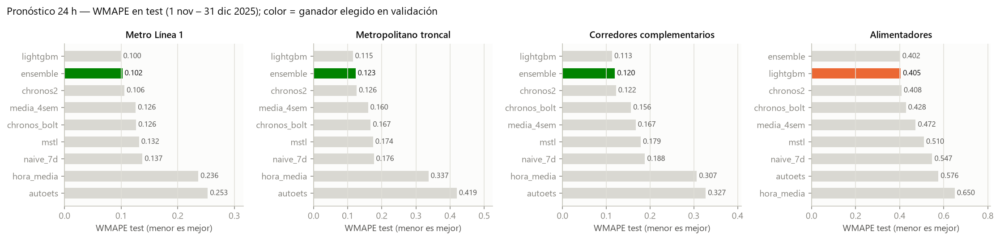

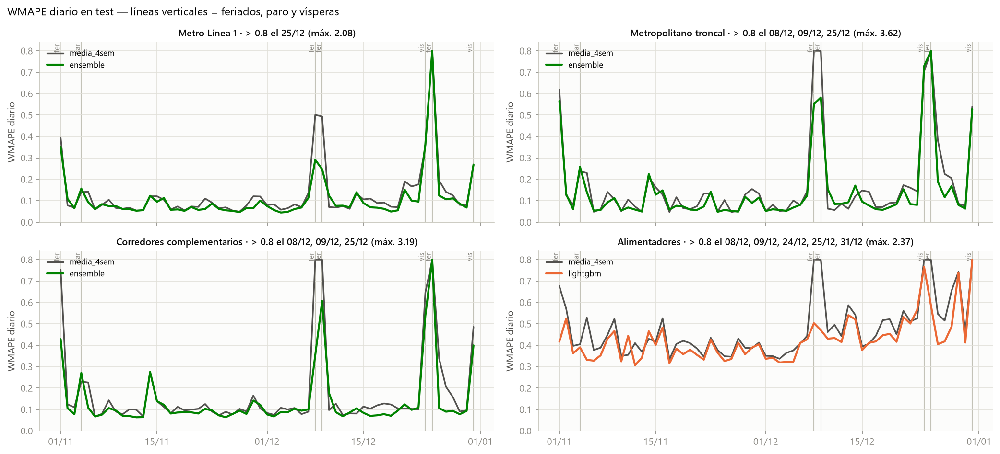

### 8.4 Bandas del 80 %

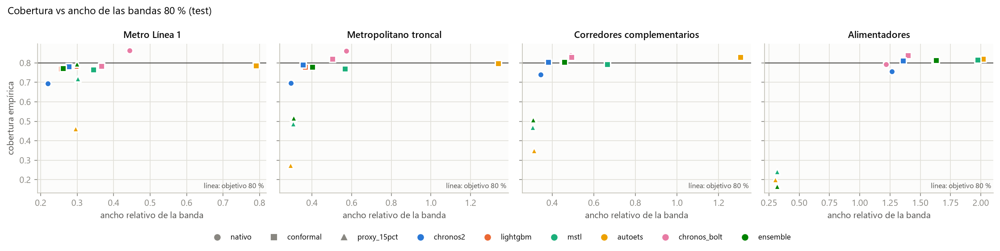

Tabla completa de cobertura

| Sistema | Modelo | Intervalo | Cobertura | Ancho relativo |
| :--- | :--- | :--- | ---: | ---: |
| Metro L1 | AutoETS | conformal | 78.5 % | 0.790 |
| Metro L1 | AutoETS | proxy_15pct | 46.2 % | 0.295 |
| Metro L1 | MSTL | conformal | 76.5 % | 0.344 |
| Metro L1 | MSTL | proxy_15pct | 72.0 % | 0.301 |
| Metro L1 | LightGBM | conformal | 76.9 % | 0.256 |
| Metro L1 | LightGBM | proxy_15pct | 78.4 % | 0.298 |
| Metro L1 | Chronos-Bolt | nativo | 86.5 % | 0.443 |
| Metro L1 | Chronos-Bolt | conformal | 78.3 % | 0.367 |
| Metro L1 | Chronos-2 | nativo | 69.5 % | 0.220 |
| Metro L1 | Chronos-2 | conformal | 78.2 % | 0.277 |
| Metro L1 | Ensemble | conformal | 77.1 % | 0.261 |
| Metro L1 | Ensemble | proxy_15pct | 79.6 % | 0.300 |
| Troncal | AutoETS | conformal | 79.8 % | 1.339 |
| Troncal | AutoETS | proxy_15pct | 27.5 % | 0.290 |
| Troncal | MSTL | conformal | 77.0 % | 0.566 |
| Troncal | MSTL | proxy_15pct | 48.7 % | 0.305 |
| Troncal | LightGBM | conformal | 77.8 % | 0.365 |
| Troncal | LightGBM | proxy_15pct | 51.8 % | 0.304 |
| Troncal | Chronos-Bolt | nativo | 86.2 % | 0.574 |
| Troncal | Chronos-Bolt | conformal | 82.1 % | 0.503 |
| Troncal | Chronos-2 | nativo | 69.7 % | 0.293 |
| Troncal | Chronos-2 | conformal | 79.0 % | 0.355 |
| Troncal | Ensemble | conformal | 77.9 % | 0.401 |
| Troncal | Ensemble | proxy_15pct | 51.7 % | 0.306 |
| Corredores | AutoETS | conformal | 83.0 % | 1.305 |
| Corredores | AutoETS | proxy_15pct | 35.0 % | 0.312 |
| Corredores | MSTL | conformal | 79.3 % | 0.665 |
| Corredores | MSTL | proxy_15pct | 47.0 % | 0.306 |
| Corredores | LightGBM | conformal | 80.6 % | 0.452 |
| Corredores | LightGBM | proxy_15pct | 51.2 % | 0.310 |
| Corredores | Chronos-Bolt | nativo | 83.9 % | 0.488 |
| Corredores | Chronos-Bolt | conformal | 82.9 % | 0.493 |
| Corredores | Chronos-2 | nativo | 74.0 % | 0.344 |
| Corredores | Chronos-2 | conformal | 80.5 % | 0.382 |
| Corredores | Ensemble | conformal | 80.4 % | 0.459 |
| Corredores | Ensemble | proxy_15pct | 50.8 % | 0.308 |
| Alimentadores | AutoETS | conformal | 82.0 % | 2.018 |
| Alimentadores | AutoETS | proxy_15pct | 20.1 % | 0.300 |
| Alimentadores | MSTL | conformal | 81.6 % | 1.976 |
| Alimentadores | MSTL | proxy_15pct | 24.3 % | 0.317 |
| Alimentadores | LightGBM | conformal | 81.1 % | 1.618 |
| Alimentadores | LightGBM | proxy_15pct | 16.9 % | 0.320 |
| Alimentadores | Chronos-Bolt | nativo | 79.4 % | 1.216 |
| Alimentadores | Chronos-Bolt | conformal | 83.9 % | 1.400 |
| Alimentadores | Chronos-2 | nativo | 75.7 % | 1.266 |
| Alimentadores | Chronos-2 | conformal | 81.0 % | 1.358 |
| Alimentadores | Ensemble | conformal | 81.4 % | 1.631 |
| Alimentadores | Ensemble | proxy_15pct | 16.7 % | 0.315 |

### 8.5 Aforo (cascada), ETA y regla U

| Sistema | Modelo | Accuracy | F1-weighted | F1-macro | F1 Saturado | RNF-01 | AC-02 | Error ETA (min) | Acuerdo regla U (AC-03) | Balanced acc. regla U |
| :--- | :--- | ---: | ---: | ---: | ---: | :---: | :---: | ---: | ---: | ---: |
| Metro L1 | Cascada Ensemble | 0.919 | 0.919 | 0.904 | 0.883 | ✅ | ✅ | 0.07 | 96.9 % | 0.846 |
| Metro L1 | HistGB directo (w08) | 0.881 | 0.879 | 0.856 | 0.826 | ✅ | ✅ | 0.10 | 96.2 % | 0.730 |
| Metro L1 | Moda histórica | 0.881 | 0.879 | 0.853 | 0.815 | ✅ | ✅ | 0.10 | 95.8 % | 0.713 |
| Metro L1 | Clase mayoritaria | 0.551 | 0.391 | 0.237 | 0.000 | ❌ | ❌ | 0.42 | 93.1 % | 0.333 |
| Metro L1 | «Siempre abordar» | – | – | – | – | – | – | – | 93.1 % | 0.333 |
| Troncal | Cascada Ensemble | 0.905 | 0.907 | 0.899 | 0.905 | ✅ | ✅ | 0.07 | 97.8 % | 0.904 |
| Troncal | HistGB directo (w08) | 0.921 | 0.920 | 0.903 | 0.884 | ✅ | ✅ | 0.06 | 97.6 % | 0.791 |
| Troncal | Moda histórica | 0.920 | 0.920 | 0.904 | 0.892 | ✅ | ✅ | 0.06 | 97.7 % | 0.793 |
| Troncal | Clase mayoritaria | 0.582 | 0.428 | 0.245 | 0.000 | ❌ | ❌ | 0.31 | 94.7 % | 0.333 |
| Troncal | «Siempre abordar» | – | – | – | – | – | – | – | 94.7 % | 0.333 |
| Corredores | Cascada Ensemble | 0.927 | 0.927 | 0.906 | 0.883 | ✅ | ✅ | 0.10 | 97.6 % | 0.935 |
| Corredores | HistGB directo (w08) | 0.921 | 0.922 | 0.890 | 0.844 | ✅ | ✅ | 0.12 | 96.5 % | 0.946 |
| Corredores | Moda histórica | 0.924 | 0.924 | 0.891 | 0.842 | ✅ | ✅ | 0.11 | 96.8 % | 0.903 |
| Corredores | Clase mayoritaria | 0.611 | 0.464 | 0.253 | 0.000 | ❌ | ❌ | 0.62 | 89.7 % | 0.500 |
| Corredores | «Siempre abordar» | – | – | – | – | – | – | – | 89.7 % | 0.500 |
| Alimentadores | Cascada LightGBM | 0.839 | 0.842 | 0.766 | 0.708 | ✅ | ❌ | 0.14 | 97.0 % | 0.636 |
| Alimentadores | HistGB directo (w08) | 0.827 | 0.831 | 0.743 | 0.659 | ✅ | ❌ | 0.15 | 96.5 % | 0.613 |
| Alimentadores | Moda histórica | 0.789 | 0.801 | 0.697 | 0.584 | ❌ | ❌ | 0.20 | 95.4 % | 0.654 |
| Alimentadores | Clase mayoritaria | 0.703 | 0.581 | 0.275 | 0.000 | ❌ | ❌ | 0.29 | 96.4 % | 0.333 |
| Alimentadores | «Siempre abordar» | – | – | – | – | – | – | – | 96.4 % | 0.333 |

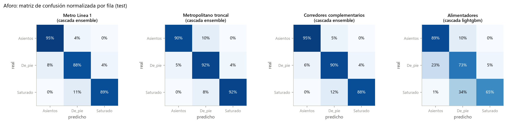

La sensibilidad de umbrales (`aforo_sensibilidad_umbrales.csv`) muestra que con umbrales p60/p90
**por franja** una fracción relevante de horas nocturnas queda como "Saturado" (clase relativa a la
franja); con umbrales globales esa fracción cae drásticamente.

### 8.6 Anomalías (feb–dic 2025, etiquetas: 16 feriados + 8 paros)

| Sistema | Detector | PR-AUC | ROC-AUC | Precisión@k | Precisión | Recall |
| :--- | :--- | ---: | ---: | ---: | ---: | ---: |
| Metro L1 | Residuo vs media 4 sem. + z robusto (v2) | 0.595 | 0.921 | 0.591 | 0.320 | 0.727 |
| Metro L1 | z del total vs mismo día de la semana | 0.590 | 0.922 | 0.565 | 0.588 | 0.435 |
| Metro L1 | IsolationForest (week08) | 0.408 | 0.630 | 0.391 | 0.529 | 0.391 |
| Troncal | Residuo vs media 4 sem. + z robusto (v2) | 0.691 | 0.896 | 0.591 | 0.304 | 0.773 |
| Troncal | z del total vs mismo día de la semana | 0.725 | 0.926 | 0.652 | 0.700 | 0.609 |
| Troncal | IsolationForest (week08) | 0.461 | 0.640 | 0.435 | 0.588 | 0.435 |
| Corredores | Residuo vs media 4 sem. + z robusto (v2) | 0.717 | 0.918 | 0.636 | 0.333 | 0.773 |
| Corredores | z del total vs mismo día de la semana | 0.717 | 0.900 | 0.652 | 0.778 | 0.609 |
| Corredores | IsolationForest (week08) | 0.226 | 0.500 | 0.174 | 0.222 | 0.174 |
| Alimentadores | Residuo vs media 4 sem. + z robusto (v2) | 0.395 | 0.830 | 0.409 | 0.286 | 0.636 |
| Alimentadores | z del total vs mismo día de la semana | 0.480 | 0.831 | 0.478 | 0.500 | 0.391 |
| Alimentadores | IsolationForest (week08) | 0.435 | 0.660 | 0.391 | 0.471 | 0.348 |

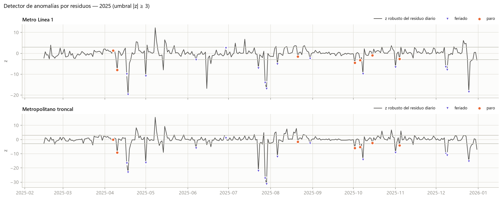

### 8.7 Conclusiones v2 y decisión para el prototipo

1. **La evaluación de week08 sobreestimaba a AutoETS y a Chronos-Bolt.**
   - En 61 días con todos los días de la semana, AutoETS(24 h) es el peor modelo (WMAPE 0.25–0.58). Era
     el ganador de week08 en troncal, corredores y alimentadores. Sin estacionalidad semanal, colapsa en
     fines de semana (0.42–0.83). Con la historia completa mejora en martes (0.137 frente a 0.183 en L1),
     pero no en sábado (0.267 con ambas ventanas).
   - Chronos-Bolt, el ganador de week08 en L1, queda detrás de los modelos v2 en los 4 sistemas.
2. **Los modelos elegidos en validación superan a la mejor baseline** (`media_4sem`) en los 4 sistemas,
   con diferencias significativas (Diebold-Mariano p < 0.01). La reducción de WMAPE es de 19 % en Metro
   L1, 23 % en troncal, 28 % en corredores y 14 % en alimentadores.
3. **LightGBM directo es el mejor modelo individual.**
   - WMAPE de test: 0.100 en L1, 0.115 en troncal, 0.113 en corredores y 0.405 en alimentadores.
   - También es el más barato: 0.4–6 min por sistema para los 78 días, frente a 12–41 min de Chronos-2
     en CPU.
   - El ensemble elegido en validación no es significativamente distinto (p = 0.28–0.63).
4. **Chronos-2 zero-shot queda a 1–10 % de LightGBM sin entrenar nada.** Es consistente con la literatura
   de 2026 (los modelos fundacionales son un baseline fuerte en transporte).
   - Su covariable de feriado reduce el error en feriados frente a las baselines (L1: 0.46 frente a 0.67).
   - Aun así, LightGBM con banderas de calendario es mejor en feriados (0.25–0.48).
5. **Los días atípicos siguen siendo el punto débil.**
   - En L1, troncal y corredores el WMAPE es 0.35–0.60 en feriados, paros y vísperas, frente a 0.08–0.09
     en días normales.
   - Alimentadores es el sistema más difícil (0.39 incluso en días normales) por su cobertura irregular.
6. **Las bandas conformal cumplen lo prometido:** cubren entre 76.5 y 83.9 % con todos los modelos
   (objetivo: 80 %). En cambio, la banda fija de ±15 % de week08 cubre entre 16.7 y 79.6 %, y los
   cuantiles nativos de Chronos-2 se quedan en 69.5–75.7 %.
7. **Aforo:** la cascada del producto cumple RNF-01 en los 4 sistemas y AC-02 en 3.
   - F1-weighted: 0.91–0.93 en L1, troncal y corredores; 0.84 en alimentadores.
   - Alimentadores falla AC-02 en "Saturado" (F1 0.71).
   - La cascada supera al clasificador HistGB de week08 en L1 y alimentadores, y empata en corredores.
     En troncal, la moda histórica (0.920) iguala o supera a la cascada (0.907): el régimen
     hora × estación explica casi todo.
8. **AC-03 se cumple, pero no discrimina:** «siempre abordar» ya acierta entre 90 y 96 %. Con balanced
   accuracy, la regla aplicada al pronóstico obtiene 0.85, 0.90, 0.93 y 0.64, frente a 0.33–0.50 de la
   baseline. **Proponemos medir AC-03 con balanced accuracy.**
9. **Alertas:** el detector causal por residuos mejora claramente al IsolationForest de week08.
   - PR-AUC: 0.59, 0.69, 0.72 y 0.39, frente a 0.41, 0.46, 0.23 y 0.44 del IsolationForest. Gana en 3
     de 4 sistemas.
   - Detecta 12–14 de los 15 feriados evaluables, pero solo 2–4 de los 7 paros.
   - En general, los paros **reducen** la demanda formal: hasta −21 % en L1, −26 % en troncal y −30 % en
     corredores. En alimentadores, en cambio, la subieron: +15 % y +21 % los días 7 y 10 de abril.
   - Parte de los "falsos positivos" son eventos reales no etiquetados (por ejemplo, el 15-jun en L1,
     con −67 %).
10. **Decisión para el prototipo (week10).**
    - Modelo principal: el ganador de validación. Es el ensemble en L1, troncal y corredores, y LightGBM
      en alimentadores. Se ejecuta en batch diario (≈ 46 s por sistema con Chronos-2).
    - **Modo ligero:** LightGBM, que responde en milisegundos y no requiere torch. Sirve para despliegues
      con poca memoria y tiene precisión estadísticamente equivalente.

### 8.8 Referencias

- Ansari, A. F. et al. (2025). *Chronos-2: From Univariate to Universal Forecasting*. arXiv:2510.15821.
- Yanes-Pulido, J. & Rodrigues, F. (2026). *Time Series Foundation Models as Strong Baselines in Transportation Forecasting*. arXiv:2602.24238.
- *It's TIME: Towards the Next Generation of Time Series Forecasting Benchmarks* (2026). arXiv:2602.12147.
- *LiveHouse-TS: An Open-world Living Benchmark for Time Series Foundation Models* (2026). arXiv:2608.17299.
- *Evaluating Accuracy and Probabilistic Reliability of Zero-Shot Time Series Foundation Models* (2026). arXiv:2609.25788.
- Stocker, M., Małgorzewicz, W., Fontana, M. & Ben Taieb, S. (2025). *A Gentle Introduction to Conformal Time Series Forecasting*. arXiv:2511.13608.
- Sabashvili (2026). *Conformal Prediction Algorithms for Time Series Forecasting: Methods and Benchmarking*. arXiv:2601.18509.
- Bandara, K., Hyndman, R. J. & Bergmeir, C. (2021). *MSTL: A Seasonal-Trend Decomposition Algorithm for Time Series with Multiple Seasonal Patterns*. arXiv:2107.13462.
- Diebold, F. X. & Mariano, R. S. (1995). *Comparing Predictive Accuracy*. JBES 13(3); Harvey, Leybourne & Newbold (1997), IJF 13(2).
