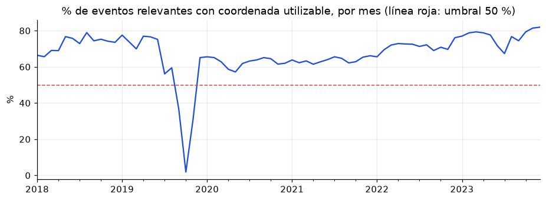
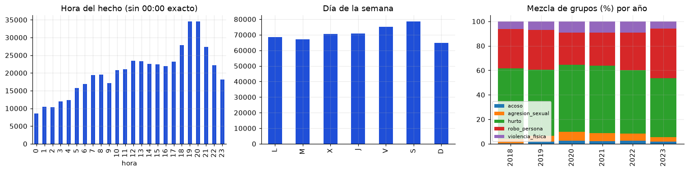
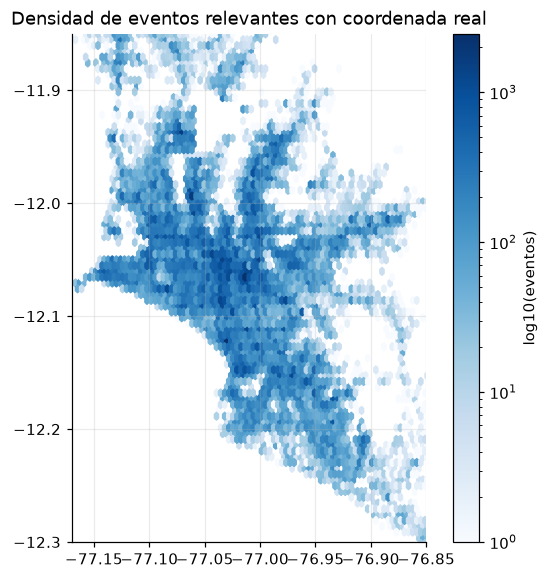

# EDA — Denuncias policiales para el Eje 2 (ruta peatonal segura)

> Notebook: [`code/eje2/notebooks/eda_denuncias_sidpol.ipynb`](../code/eje2/notebooks/eda_denuncias_sidpol.ipynb) ·
> Reglas compartidas: [`code/eje2/eje2_common.py`](../code/eje2/eje2_common.py) ·
> Diccionario: [`data_dictionary/denuncias_sidpol.md`](data_dictionary/denuncias_sidpol.md)

Todas las cifras de este documento salen del notebook y usan **train + valid (hasta diciembre de 2023, 2 050 050 filas)**. El test y la reserva no se abrieron.

## 0. Contexto y dataset plan

**Para qué.** El Eje 2 necesita un riesgo por calle en el entorno (~10 min a pie, 800 m) de cada punto de acceso:
estaciones del Metro L1, estaciones del Metropolitano, y paraderos de corredores y alimentadores. La única fuente con
ubicación del hecho es la base de denuncias SIDPOL (MININTER). Este EDA decide qué filas sirven y qué hay que corregir.

| Elemento | Decisión |
|---|---|
| Fuente | Denuncias policiales SIDPOL, Lima y Callao, unificadas de 140 CSV y 3 GeoJSON (los archivos se solapaban: se quitaron 2,88 millones de filas repetidas por `id_dgc`) |
| Granularidad | una fila = una denuncia; 2 594 332 filas únicas, 57 columnas originales + `origen` |
| Formato | El CSV unificado pesa 1,4 GB → **parquet** (~128 MB en total), partido **por año del hecho** en 9 archivos de menos de 25 MB (`raw/denuncias_<año>.parquet`, y `denuncias_antes_2018.parquet`) para poder subirlos a GitHub. El script 01 los junta y recupera el orden original. El CSV queda en `data/` (ignorado por git) |
| Partición | Temporal, en disco, con `splits/manifest.json` (SHA-256): `train` ≤ 2022 (1 603 871) · `valid` 2023 (446 179) · **`test` enero–agosto de 2024 (283 138), sellado** · `reserva` septiembre de 2024 – junio de 2025 (261 144), **no se usa** |
| Por qué hay una reserva | Septiembre de 2024 en adelante tiene entre 11 % y 51 % de coordenadas utilizables por mes: casi todo quedó en el centroide de la comisaría y no sirve para ubicar eventos en calles |
| Validación | Ventanas móviles dentro de train + valid (años 2021, 2022 y 2023), ver `Model_Eje2.md` |
| Columnas usadas | fecha y turno del hecho, lat/long, `observacion` (calidad de la coordenada), distrito, comisaría, tipo/subtipo/modalidad |
| Qué no se usa | las 9 columnas casi vacías, variables socioeconómicas o de "calidad de vida" del barrio |

## 1. Data Understanding

- 2 050 050 filas en train + valid; `id_dgc` único. 43 columnas de texto, 9 enteros, 3 fechas, 3 decimales; 5,6 GB en memoria.
- Provincias: Lima 1 818 614 y Callao 231 358; solo 78 filas de otras provincias.

## 2. Preprocessing

### 2.1 Nulos por columna
Solo 9 de 57 columnas tienen nulos, todas casi vacías: `tipologias_ia` 100 %, `cuadra_hecho` 98,0 % y siete de una capa
de comisarías (`barrio`, `comisaria`, `departamento`, `provincia`, `distrito`, `fecha_inaguracion`, `indice_priorizacion`) 95,9 %.
**Decisión: se descartan.** El resto tiene 0 % de nulos, incluidas `lat_hecho` y `long_hecho`.

### 2.2 Nulos disfrazados
`lat_hecho` y `long_hecho` nunca están vacías, pero **28,3 % de las filas (581 057) tienen la coordenada puesta en el
centroide de la comisaría** (`observacion = GEO FORZADA AL CENTROIDE DE COMISARIA`), en solo 96 puntos distintos.
`estado_coord` engaña: marca "SIN COORDENADA" en 2 035 filas que fueron corregidas a mano y sí sirven. Se define
`coord_real = observacion ≠ forzada`: **71,7 %** de las filas. Por año: 94,0 % (2018) → 70,2 % (2019) → 64–70 % (2020–2023).

### 2.3 ¿La falta de coordenada es aleatoria?
| Variable | V de Cramér | | Modelo logístico de "falta coordenada" | AUC |
|---|---|---|---|---|
| Grupo de hecho | 0,70 | | solo año | 0,602 |
| Comisaría | 0,70 | | + comisaría | 0,928 |
| Tipo de vía | 0,47 | | + tipo de hecho y turno | 0,971 |
| Distrito | 0,41 | | + texto de la dirección | 0,973 |
| Año | 0,21 | | | |
| Turno | 0,18 | | | |

- **No es MCAR**: depende fuertemente de la comisaría que registra.
- **Es MAR (semi-aleatoria)**: dada la comisaría y el periodo casi no queda nada por explicar; la calidad de la dirección
  agrega solo +0,002 de AUC.
- **MNAR no se puede descartar**: si una comisaría geocodifica peor ciertas calles, la falta dependería del lugar del hecho, que no vemos.
- **Tratamiento**: no se imputan ubicaciones; se **pondera por cobertura** (`1 / P(coordenada utilizable | comisaría, año)`, con tope de 4) y se declara el sesgo.

### 2.4 Coordenadas
- **23,4 % de las coordenadas "reales" son puntos por defecto**: 115 puntos repetidos ≥ 500 veces (344 237 filas). El mayor, en el
  Cercado de Lima, acumula 61 989. **Se excluyen** (`clean/puntos_apilados.parquet`, calculado solo con train).
- 601 filas con `VERIFICAR/CORREGIR UBIGEO`: se conserva la bandera `verificar_ubigeo`.
- 100 % dentro del cuadro de Lima/Callao; sin lat/long invertidas. Respecto a la mediana de su distrito: 1,7 km (mediana),
  8,1 km (p99), 23,9 km (p99,9); solo 0,28 % pasan de 15 km. No se eliminan.

### 2.5 Outliers
| Qué | Hallazgo | Decisión |
|---|---|---|
| Año < 2018 | 8 432 filas (40 años, desde 1923; 4 844 son 2017) | descartar |
| Registro anterior al hecho | 17 167 (0,84 %); retraso > 1 año: 15 043 | conservar, no afecta ubicación |
| Hora `00:00` exacta | 49 878 (2,4 %); pesa más que toda la hora 01:00–01:59 (40 675) → valor por defecto | excluir de análisis por hora; conservar `turno` |
| Concentración por celda de 250 m | 11 784 celdas; valla IQR = 113; 9,7 % de las celdas tiene 51,9 % de eventos | puntos calientes reales: conservar y suavizar |
| **Cobertura mensual** | % de eventos relevantes con coordenada **utilizable** (real y no apilada): sep-2019 **37 %**, oct-2019 **2 %**, nov-2019 **30 %** (con totales estables) | excluir esos 3 meses del objetivo del modelo |



La cobertura se mide **solo sobre eventos relevantes** (si se midiera sobre todas las denuncias, las intervenciones policiales, con
9,6 % de coordenada real, la deprimirían) y descontando las coordenadas apiladas. Promedio por año: 72,5 % (2018), 59,8 %, 63,4 %, 63,8 %,
71,3 % y 77,1 % (2023). Sin esta corrección un modelo concluiría que las calles se volvieron seguras en esos tres meses. La cobertura por comisaría
y año (803 celdas, mediana 0,93) se calcula solo con los meses válidos para no penalizar dos veces la exposición. **La misma regla (≥ 50 % por mes)
se aplica a cualquier periodo que se evalúe.**

### 2.6 Imputación por geocodificación (¿recuperar la ubicación desde la dirección?)
Se probó Nominatim (OpenStreetMap) sobre 100 denuncias con coordenada real y 100 forzadas. Se encontraron **9 de 100** y **16 de 100**. En las 9 con
coordenada conocida el error mediano fue 316 m (33 % dentro de 100 m, 44 % dentro de 250 m) y el p90 llegó a 12,9 km.
**Decisión: no imputar.** Trabajo futuro: un geocodificador local que entienda manzana/lote.

## 3. Exploratorio

### 3.1 Qué sirve y qué no sirve
| Grupo | Filas totales | Útiles tras filtros | ¿Sirve? | Motivo |
|---|---:|---:|:-:|---|
| Hurto | 369 736 | 262 646 | Sí | riesgo del peatón |
| Robo a la persona | 236 394 | 163 474 | Sí | riesgo principal |
| Violencia física | 55 214 | 36 650 | Sí | lesiones, homicidio, tentativas en la calle |
| Agresión sexual | 45 129 | 24 479 | Sí | violación, tocamientos, actos contra el pudor |
| Acoso | 13 848 | 8 155 | Sí | señal propia; pocos casos y muy subregistrada |
| Violencia familiar | 474 431 | 0 | No | ocurre en el hogar, no es inseguridad en la calle |
| Intervenciones policiales | 408 236 | 0 | No | visitas, desaparecidos; solo 9,6 % con coordenada real |
| Fraude / extorsión / informáticos | 146 780 | 0 | No | sin ubicación callejera |
| Vehículos y autopartes | 68 559 | 0 | No | no es riesgo del peatón |
| Hurto en casa habitada | 8 908 | 0 | No | domicilio |
| Otros (ebriedad, desobediencia, faltas menores) | 222 815 | 0 | No | ver notebook |

**Embudo:** 2 050 050 → 720 321 (grupo útil) → 622 106 (coordenada real) → 497 874 (no apilada) → 495 404 (2018–2023) →
**495 374 (Lima/Callao, 24,2 %)**. Train 364 647, valid 130 727.

### 3.2 Patrones
- El robo a la persona es el más nocturno (38,5 % de noche); el acoso ocurre sobre todo de día (32,2 % tarde, 10,9 % madrugada);
  la agresión sexual pesa más en la madrugada (21,7 %).
- Sesgo de cobertura por distrito: SJL y Lima con 0 % forzado; Los Olivos, El Agustino, Villa El Salvador e Independencia con 52–59 %.




## 4. Findings
1. Solo ~24 % de las filas sirven para riesgo por calle.
2. Los nulos están disfrazados: 28,3 % de lat/long son centroides de comisaría; `estado_coord` no es confiable.
3. La falta de coordenada es MAR, no MCAR; MNAR no se descarta. Se corrige ponderando, no imputando.
4. La geocodificación de direcciones no es viable (9–16 % de éxito).
5. 23,4 % de las coordenadas "reales" son puntos por defecto repetidos.
6. La cobertura utilizable se desploma en sep–nov 2019 (2–37 %); la regla de ≥ 50 % por mes se aplica a todo periodo evaluado.
7. Hay fuerte concentración espacial; se mantiene y se suaviza.

## 5. Limitations
- **Subregistro**: una denuncia no es un delito. El acoso y la violencia sexual se denuncian mucho menos de lo que ocurren.
- **Sesgo social**: la decisión de denunciar y la confianza en la policía varían entre zonas; no se corrige.
- **Cobertura desigual**: las zonas de comisarías que casi no geocodifican aparecen más seguras de lo que son.
- **Lugar de registro**: una denuncia se registra donde se presenta, no necesariamente donde ocurrió.
- **Sin variables de "calidad de vida"**: no se usa ingreso ni nivel socioeconómico para no penalizar barrios.
- **Muestra pequeña** en la prueba de geocodificación (n = 100 por grupo).

## 6. Reproducibilidad
```
python code/eje2/scripts/00_csv_a_parquet.py    # CSV → raw/denuncias_<año>.parquet
python code/eje2/scripts/01_split_temporal.py   # splits + manifest
jupyter nbconvert --execute code/eje2/notebooks/eda_denuncias_sidpol.ipynb   # desde la carpeta notebooks/
```
Semilla `random_state = 0`. La prueba de geocodificación queda en caché (`clean/geocode_muestra.parquet`).

Salidas en `data_processed/eje2/clean/`: `denuncias_eje2_clean.parquet`, `puntos_apilados.parquet`, `meses_baja_cobertura.csv`,
`cobertura_comisaria_anio.csv`, `embudo_filtros.csv`, `resumen_calidad_anio_grupo.csv`, `geocode_muestra.parquet`.
