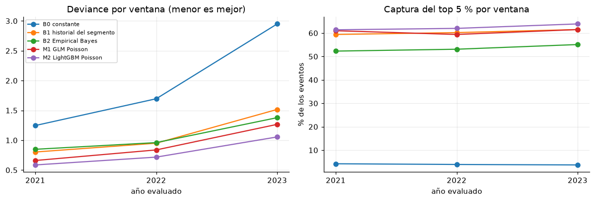
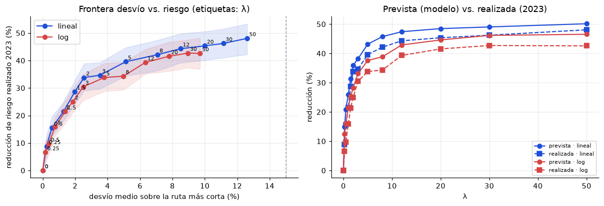

# Modelo del Eje 2 — riesgo por calle y ruta peatonal segura

> Notebooks: [`fe_riesgo_calles`](../code/eje2/notebooks/fe_riesgo_calles.ipynb) ·
> [`modelamiento_riesgo_calles`](../code/eje2/notebooks/modelamiento_riesgo_calles.ipynb) ·
> [`ruteo_seguro_pesos`](../code/eje2/notebooks/ruteo_seguro_pesos.ipynb) · Antecedente: [`EDA_Eje2.md`](EDA_Eje2.md)

## 1. Qué se modela y por qué así

**Pregunta del Eje 2:** si una persona está a ~10 minutos caminando de una estación o paradero (Metro L1, Metropolitano, corredores o
alimentadores) y quiere llegar a ella, **¿qué camino es más seguro?** La respuesta equilibra distancia y seguridad. Como contexto secundario, la app también
resume qué tan seguro es el entorno de cada estación o paradero (sección 5).

Para eso se estima, **por segmento de calle**, cuántos eventos callejeros (robo, hurto, acoso, agresión sexual, violencia física) se registran por año,
y ese riesgo se usa como peso de un grafo. Lo que importa para el ruteo es el **orden relativo** de las calles, no la cifra exacta de eventos: el costo
`largo × (1 + λ · riesgo)` usa un riesgo en escala 0–1. Por eso el modelo sirve aunque no acierte el nivel absoluto.

| Pieza | Decisión |
|---|---|
| Zona | Entorno de **800 m caminando** (~10 min) de 1 775 puntos de acceso: 26 estaciones Metro L1, 44 del Metropolitano, 993 paraderos de corredores, 712 de alimentadores |
| Calles | Grafo peatonal de OSM descargado **offline** (osmnx solo en `scripts/02_descarga_osm.py`): 188 893 segmentos, de los cuales **146 607 (7 012 km)** caen en alguna zona |
| Eventos | 495 374 denuncias limpias del EDA (hasta 2023); **237 498 (47,9 %)** caen a ≤ 40 m de un segmento de zona |
| Grano | segmento × año objetivo (733 035 filas, objetivos 2019–2023) |
| Objetivo | conteos observados del año (`y_total`, `y_noche`, `y_dia`, `y_pat`, `y_per`) con **offset de exposición** |
| Exposición | `meses válidos / 12 × cobertura(comisaría, año)`: corrige que en meses y comisarías con pocas coordenadas utilizables se ven menos eventos |
| Features | solo del pasado (años < objetivo): tasas históricas ponderadas por cobertura, año anterior, decaimiento (vida media 1,5 años), tasa por tipo, fracción nocturna, calles vecinas a 1 y 2 saltos, tipo de vía, largo, POIs de OSM |
| Qué no se usa | ingreso, nivel socioeconómico o "calidad de vida" del barrio (regla del proyecto) |

### Protocolo de evaluación
| Etapa | Qué se hace |
|---|---|
| Partición | `train` ≤ 2022 · `valid` 2023 · **`test` enero–agosto de 2024** · `reserva` septiembre de 2024 – junio de 2025 (no se usa: menos de la mitad de las coordenadas son utilizables) |
| Hiperparámetros | corte interno: entrena con objetivos ≤ 2021 y ajusta en 2022 (K de Empirical Bayes, α del GLM, iteraciones de LightGBM) |
| Ventanas móviles | para 2021, 2022 y 2023 se entrena con los años anteriores y se evalúa en ese año |
| Reglas de decisión | fijadas antes de mirar resultados: modelo = menor deviance media en las ventanas; un bloque de features se conserva si baja la deviance media; λ con tope de desvío y parsimonia |
| Test | se evalúa **una sola vez** con los modelos ya fijados; luego se reentrena con todo para producción |

## 2. Ventanas móviles (validación)

Deviance de Poisson (menor es mejor):

| Modelo | 2021 | 2022 | 2023 | **Media** | Desv. est. |
|---|---:|---:|---:|---:|---:|
| B0 constante | 1,247 | 1,695 | 2,950 | 1,964 | 0,883 |
| B1 historial del segmento | 0,803 | 0,951 | 1,516 | 1,090 | 0,377 |
| B2 Empirical Bayes (K = 0,5) | 0,849 | 0,961 | 1,379 | 1,063 | 0,279 |
| M1 GLM Poisson (α = 1e-4) | 0,661 | 0,838 | 1,266 | 0,922 | 0,311 |
| **M2 LightGBM Poisson** (403 iteraciones) | **0,586** | **0,717** | **1,055** | **0,786** | **0,242** |

- **LightGBM gana en las tres ventanas**: 28 % menos deviance que el historial y 15 % menos que el GLM, con la menor dispersión.
- **Captura del top 5 % (media):** LightGBM 62,4 %, GLM 60,6 %, historial 60,4 %, Empirical Bayes 53,5 %. En el top 10 %: 74,1 %, 73,5 %, 73,2 %, 66,2 %.
  *Captura top-k*: parte de los eventos del año que cae en el k % de segmentos que el modelo marcó como más riesgosos.
- El historial ordena mejor el conjunto completo (Spearman medio 0,442 frente a 0,384), pero eso no se refleja en deviance ni en captura.
- **El nivel de eventos no es estable**: LightGBM predice 58 %, 65 % y 56 % de lo observado en 2021, 2022 y 2023. Cada año tuvo una tasa más alta que su historia (la tasa ajustada fue 0,245 → 0,318 → 0,529).



### Ablaciones (LightGBM, deviance media en las tres ventanas)
| Variante | Deviance | Cambio |
|---|---:|---:|
| Completo | 0,7863 | – |
| Sin POIs | 0,7867 | +0,0004 |
| Sin largo | 0,8039 | +0,0176 |
| Sin vecindad | 0,8121 | +0,0257 |
| Solo historial propio | 0,8356 | +0,0493 |

Ganancia de LightGBM: `tasa_prev` 40,4 %, `tasa_all` 27,8 %, `decay` 16,7 %, `vec2` 4,8 %, `length_m` 3,1 %. Vecindad y largo aportan en las tres ventanas.
Los **POIs** aportan +0,0004 y ayudan en una de las tres ventanas (solo 11,3 % de los segmentos tiene un POI de OSM a ≤ 50 m): se conservan por la regla pero no se presentan como explicación del riesgo.

### Calibración en 2023
El modelo entrenado hasta 2022 **subpredice en todos los deciles** (observado/previsto de 1,3 a 1,8; total 37 149 previstos frente a 65 919 observados) y de forma parecida en todos los niveles de cobertura
(2,10 / 1,68 / 1,76). Es un problema de nivel por el salto de la tasa en 2023, no de cobertura.

## 3. Test (enero–agosto de 2024)

Los 8 meses del test cumplen la regla de cobertura (entre 82,8 % y 89,0 % de los eventos relevantes con coordenada utilizable). 283 138 denuncias → 91 918 útiles → 47 350 asignadas a segmentos de la zona.

| Modelo | Deviance | MAE | Spearman | Captura top 5 % | Captura top 10 % | Previsto / observado |
|---|---:|---:|---:|---:|---:|---:|
| B0 constante | 2,292 | 0,485 | – | 3,6 % | 8,3 % | 0,62 |
| B1 historial del segmento | 0,988 | 0,313 | **0,460** | 67,1 % | 78,5 % | 0,67 |
| B2 Empirical Bayes | 0,992 | 0,408 | 0,362 | 61,7 % | 72,9 % | 1,00 |
| M1 GLM Poisson | 0,768 | 0,354 | 0,394 | 67,5 % | 78,2 % | **1,00** |
| **M2 LightGBM Poisson** | **0,701** | 0,329 | 0,407 | **70,2 %** | **80,3 %** | 1,11 |

- LightGBM tiene la menor deviance (29 % menos que el historial) y **captura el 70,2 % de los eventos en el 5 % de calles** que marca como más riesgosas.
- Sobrepredice 11 % el nivel (el GLM lo clava). Por decil, sobrepredice en los bajos (0,4–0,6) y acierta en los altos (0,9–1,0); por cobertura 0,95 (baja), 0,85 (media), 0,91 (alta).
- La captura del test (70,2 %) es mayor que la de las ventanas (61–64 %); el test entrena con 5 años de objetivos y las ventanas con 2 a 4.

## 4. Riesgo por segmento
Se entrenan 4 modelos (total, noche, día, persona). Riesgo = densidad (eventos esperados por km y año, largo mínimo 50 m) llevada a 0–1 con
`log1p(d)/log1p(p99)`. El p99 (total: 55,6 eventos/km·año) se fija con la predicción de validación 2023 y se usa igual en el test y en producción; como el nivel de eventos subió,
satura en 1 el 2,2 % (test) y 2,0 % (producción) de los segmentos, en lugar del 1 %. Por tipo de vía el riesgo medio de producción es mayor en arteriales (0,391) y menor en peatonales (0,177).
**Producción:** modelos reentrenados con objetivos 2019–2023 y enero–agosto de 2024, y features con eventos hasta agosto de 2024.

## 5. Índice por punto de acceso (con su base) — contexto secundario

Complementa a la ruta segura: resume el entorno de cada estación o paradero. Para cada acceso se calculan los eventos esperados por km caminable (ER) en sus 800 m, y:

- **Seguridad %** = `100 × (1 − ER / ER_p95)` (0 equivale al 5 % de accesos con más riesgo esperado).
- **Base %** = mediana de Seguridad % de los accesos **del mismo tipo**.
- **Intervalo 90 %** por *bootstrap* de los segmentos del entorno, y **confianza** (alta/media/baja) según eventos históricos del entorno, cobertura de la
  comisaría, distancia al nodo de la red y, en alimentadores, `precision` de la coordenada.

| Tipo | Puntos | Seguridad mediana (= base) | Ancho medio del intervalo | Confianza alta | Confianza baja |
|---|---:|---:|---:|---:|---:|
| Alimentador | 712 | 95,2 % | 6,3 | 44,7 % | 7,3 % |
| Corredor | 993 | 68,0 % | 19,8 | 96,6 % | 0 % |
| Metro L1 | 26 | 71,2 % | 20,5 | 100 % | 0 % |
| Troncal (Metropolitano) | 44 | 54,5 % | 19,4 | 88,6 % | 0 % |

Ejemplos de lectura: *Jirón de la Unión* (troncal) 0 % frente a una base de 55 %; *Celima* (corredor) 79 % (63–97) frente a 68 %, confianza media; *Hospital Los Olivos* (alimentador) 60 % (45–73) frente a 95 %.

**Cómo debe mostrarse:** "Seguridad 79 % (63–97 %), base 68 % para corredores. Estimación aproximada con denuncias registradas." **Los alimentadores salen
"muy seguros" sobre todo por menos registro y menos coordenadas utilizables en zonas periféricas**: significa menos denuncias esperadas, no menos delito. Nunca como probabilidad
de ser víctima.

## 6. Ruteo seguro y elección de λ

Costo por calle `largo × (1 + λ · riesgo)`, riesgo en [0, 1] y λ = 0 la ruta más corta. Se resuelve con **Dijkstra** (`scipy.sparse.csgraph`).

**Punto de partida (revisión de documentación):**
- Galbrun, Pelechrinis y Terzi, *Urban navigation beyond shortest route: the case of safe paths*, [Information Systems 57 (2016)](https://www.sciencedirect.com/science/article/abs/pii/S0306437915001854): longitud y riesgo no se combinan en un solo objetivo; proponen conjuntos de rutas con distintos compromisos.
- Columbus, OH ([rathem30/safe-routes](https://github.com/rathem30/safe-routes)): `largo × (1 + λ·ln(1 + riesgo))` con λ entre 0 y 3.
- Penn ([Jayden23018/safepath](https://github.com/Jayden23018/safepath)): `largo × (1 + 1,5·riesgo_norm)`.
- Tshwane, Sudáfrica ([Springer, 2026](https://link.springer.com/article/10.1007/s12198-026-00363-w)): la ruta más segura fue ~63 % más larga y expuso a casi la mitad de incidentes.

**Método.** 1 308 pares origen-destino (210 orígenes de los cuatro tipos; destinos a 400–800 m caminando; ruta más corta mediana 627 m).
Forma lineal y logarítmica; λ ∈ {0; 0,25; 0,5; 1; 1,5; 2; 3; 5; 8; 12; 20; 30; 50}. Se mide el **desvío** y la **reducción del riesgo realizado en 2023**
(eventos observados en las calles de la ruta) con riesgo previsto **solo con datos hasta 2022**.
**Regla:** desvío medio ≤ 15 % y p90 ≤ 30 %; entre las que logran ≥ 95 % de la mejor reducción, la de menor desvío.

| λ (lineal) | Desvío medio | Desvío p90 | Reducción prevista | Reducción realizada 2023 (IC 95 %) |
|---:|---:|---:|---:|---:|
| 1 | 1,3 % | 4,1 % | 26,0 % | 21,4 % (18,0–25,1) |
| 3 | 3,5 % | 10,2 % | 38,2 % | 34,7 % (29,7–39,3) |
| 8 | 7,1 % | 19,5 % | 45,7 % | 42,1 % (36,3–47,4) |
| **12** | **8,5 %** | **23,6 %** | **47,4 %** | **44,3 % (39,2–49,8)** |
| 30 | 11,2 % | 29,5 % | 49,1 % | 46,2 % (41,0–51,5) |
| 50 | 12,6 % | 33,2 % | 50,1 % | 48,1 % (42,2–53,4) |



**Elegido: forma lineal, λ = 12** (valor inicial, configurable). Rendimientos decrecientes después: de 12 a 50 el desvío sube 4 puntos y la reducción 3,8. La forma logarítmica es algo menos eficiente.
Comprobaciones: λ = 0 = camino más corto de `networkx` (diferencia 1e-13 m); la reducción prevista no baja al subir λ; de noche (riesgo nocturno) el desvío es 9,3 % y se evita **48,3 %** de lo ocurrido de noche.

**Confirmación en el test (enero–agosto de 2024), medida una sola vez con λ = 12:** desvío medio 8,7 % (p90 22,6 %), reducción prevista 45,7 % y **reducción realizada 43,8 % (IC 95 % 38,6–50,2)**;
de noche, desvío 10,4 % y 50,6 % menos. Por tipo de acceso en el test: alimentador 70,3 %, troncal 47,2 %, corredor 45,1 % y Metro 27,6 % (156 pares).

## 7. Limitaciones
- **Es una tendencia, no una garantía por calle.** El ordenamiento global es modesto (Spearman ≈ 0,41): entre dos calles paralelas con riesgo parecido la diferencia puede ser ruido.
  Lo sólido es "evita las calles con más denuncias" en promedio (43,8 % menos riesgo realizado en el test), no "esta calle es segura".
- **Solo hay riesgo dentro de los ~10 min de una estación o paradero.** El grafo cubre esas zonas; las alternativas que salen de ellas no existen. El origen del usuario
  debe ajustarse a la calle más cercana dentro de la zona.
- **Qué mostrar en la app:** "esta ruta tarda X % más y evita calles con más denuncias" junto a la ruta más corta; no conteos absolutos de eventos ni un "% de seguridad" de una calle individual.
- **Denuncias ≠ delito**: subregistro (muy alto en acoso y violencia sexual), sesgo de quién denuncia y de dónde se registra. "Riesgo realizado" son denuncias registradas.
- **Cobertura desigual** entre comisarías y a lo largo del tiempo; se corrige con exposición bajo el supuesto MAR (EDA §2.3), que no se puede verificar.
- **El nivel de eventos no se predice bien** (previsto/observado de 0,56 a 0,65 en las ventanas, 1,11 en el test): el modelo sirve para ordenar y comparar, no para dar conteos absolutos.
- Los datos de septiembre de 2024 en adelante no se pueden usar (menos de la mitad de coordenadas utilizables): el riesgo de producción refleja hasta agosto de 2024.
- Coordenadas aproximadas en 57 % de los paraderos de alimentadores; OSM con poca cobertura de POIs (11 %).
- 52 % de los eventos limpios cae fuera de las zonas de 10 min; el modelo describe los entornos de acceso, no toda Lima.
- La zona usa distancia de red desde el nodo más cercano al punto de acceso, no la geometría real del paradero.
- En Metro el efecto de la ruta segura es menor (28 % en el test) y la muestra es pequeña.

## 8. Artefactos y reproducibilidad
```
python code/eje2/scripts/00_csv_a_parquet.py      # CSV -> raw/denuncias_<año>.parquet (9 archivos, < 25 MB c/u)
python code/eje2/scripts/01_split_temporal.py     # splits + manifest (test sellado)
python code/eje2/scripts/02_descarga_osm.py       # grafo y POIs de OSM (offline; ~1 h; reanudable)
# luego, desde code/eje2/notebooks/: eda -> fe -> modelamiento -> ruteo (jupyter nbconvert --execute)
```
Semilla `random_state = 0`. Dependencias: `requirements-eje2.txt`.

| Artefacto | Contenido |
|---|---|
| `models/eje2/lgbm_{total,noche,dia,persona}_v1.txt`, `manifest.json` | modelos de producción (LightGBM, formato texto) y su manifest |
| `data_processed/eje2/outputs/riesgo_segmentos.parquet` | riesgo por segmento (producción) |
| `data_processed/eje2/outputs/riesgo_valid2023.parquet`, `riesgo_test2024.parquet` | riesgo de validación y de test, con los eventos reales, para validar el ruteo |
| `data_processed/eje2/outputs/indice_puntos_acceso.parquet` | índice por estación/paradero con base, intervalo y confianza |
| `data_processed/eje2/outputs/{ventanas_moviles,ablaciones_ventanas,bakeoff_test2024,lambda_barrido,lambda_elegido,lambda_confirmacion_test,...}` | métricas y decisiones |
| `data_processed/eje2/export/grafo_ruteo.parquet` | grafo de 146 607 segmentos con riesgo 0–1 (total, noche, día): **lo único que necesita el backend** |

## 9. Próximos pasos
1. Backend: cargar `grafo_ruteo.parquet`, aplicar `largo × (1 + λ·riesgo)` con λ = 12 y mostrar siempre la ruta más corta como alternativa.
2. Reportes de usuarios (acoso, seguimiento, robo) para recalibrar el riesgo sin exponer reportes individuales; botón de alerta con llamada al 105.
3. Recalcular el riesgo cuando se disponga de datos recientes con coordenadas corregidas.
4. Un geocodificador local para recuperar la ubicación de las denuncias sin coordenada.
